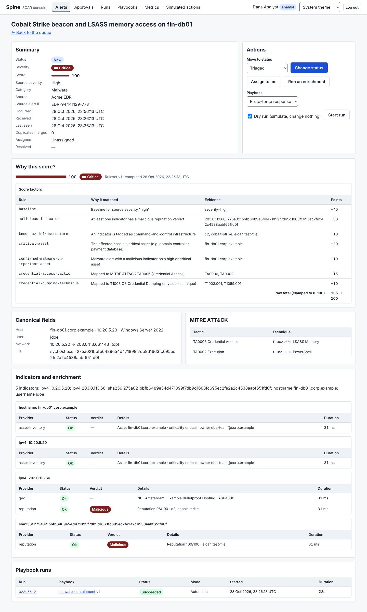
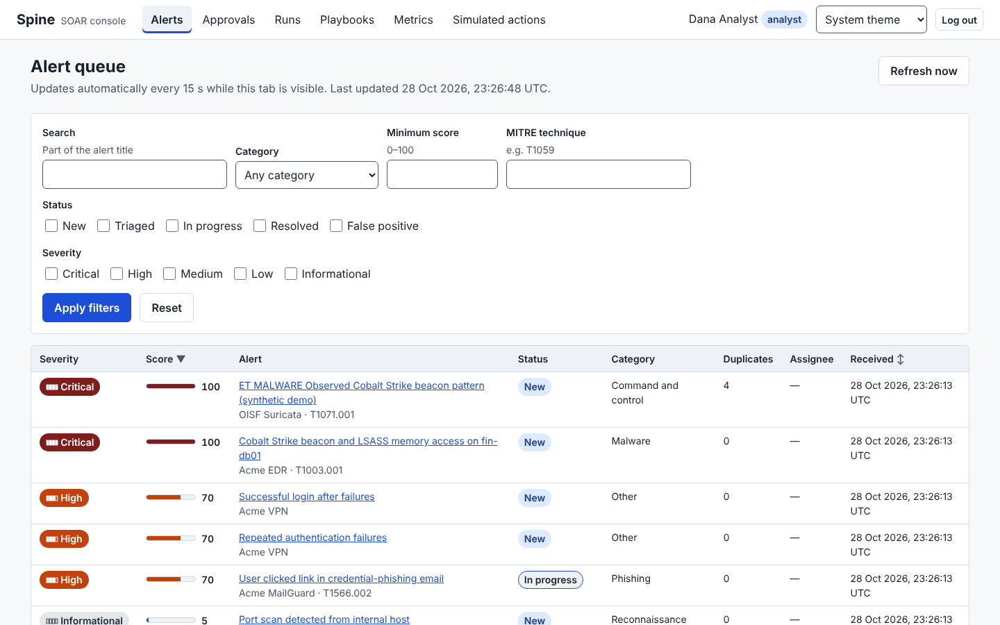
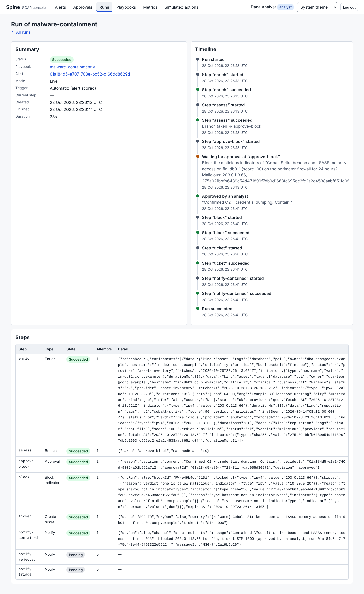
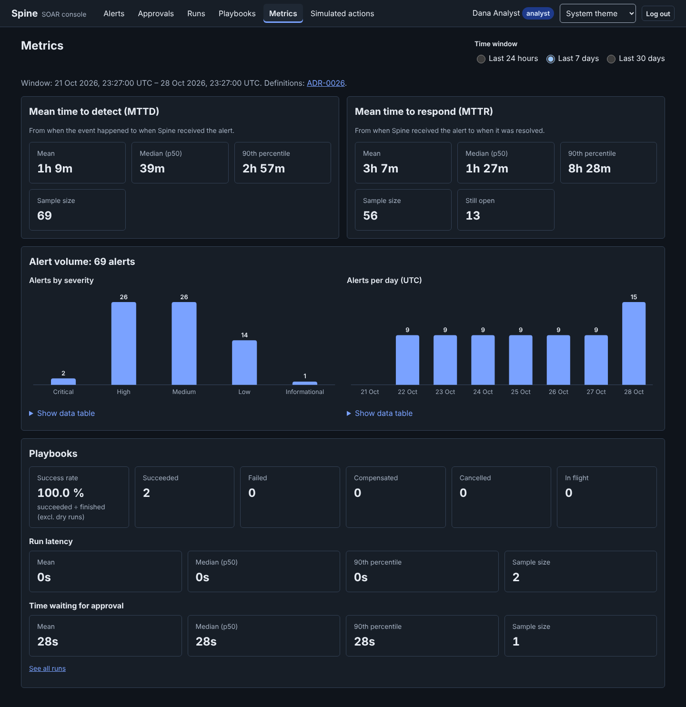
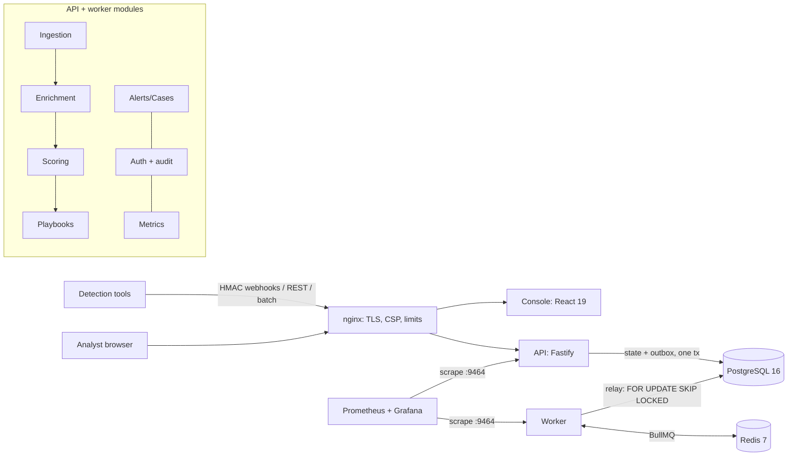

# Spine

[](https://github.com/abdoukh4-art/spine/actions/workflows/ci.yml)
[](https://github.com/abdoukh4-art/spine/actions/workflows/security.yml)


**An open-source, teaching-grade SOAR platform** (Security Orchestration, Automation and Response).

Spine ingests alerts from detection tools, enriches and scores them with **explainable** rules, and
runs **durable, approval-gated playbooks** through **simulated** integrations. It is built as a
production-style system _and_ as a learning resource: 70+ architecture decision records, module
guides with exercises, three hands-on tutorials, and an honest engineering journal (including the
bugs).



## What it does

```
 detection tools ──▶ INGEST ──▶ ENRICH ──▶ SCORE ──▶ PLAYBOOK ──▶ (approval) ──▶ RESPOND ──▶ MEASURE
 webhooks · REST     canonical   reputation  rules +    YAML DAG     analyst       firewall,   MTTD, MTTR,
 CEF/Suricata files  schema,     geo, asset  evidence,  branches,    approves      ticket,     success rate
                     ATT&CK,     (timeouts,  severity   retries,     in console    chat        (Grafana +
                     dedup,      breakers,              compensation               — all       console)
                     idempotency bulkheads)             durable runs               SIMULATED
```

- **One canonical alert** from Suricata EVE, CEF/syslog, signed webhooks or REST, with MITRE ATT&CK
  mapping, fingerprint deduplication and `Idempotency-Key` support ([ADR-0011](docs/adr/0011-canonical-alert-schema.md), [0012](docs/adr/0012-idempotency-and-deduplication.md)).
- **Resilient enrichment:** per-provider timeout, retry with full jitter, circuit breaker and bulkhead,
  written by hand and property-tested ([ADR-0014](docs/adr/0014-hand-written-resilience-primitives.md)).
- **Explainable scoring:** additive, versioned YAML rules. Every factor shows its evidence, and data
  gaps are called out ([ADR-0015](docs/adr/0015-explainable-rule-based-scoring.md)).
- **Durable playbooks:** a validated DSL (no `eval`), event-sourced runs that resume after a crash
  with exactly-once side effects, approval gates, retries, saga compensation, dry-run
  ([ADR-0010](docs/adr/0010-event-sourcing-for-playbook-runs-only.md), [0013](docs/adr/0013-playbook-dsl.md)).
- **Safe by design:** response actions are simulated ([ADR-0018](docs/adr/0018-simulated-response-adapters.md)),
  plus deny-by-default RBAC, rotating refresh tokens with reuse detection, and an append-only audit log.
- **Operable:** health and readiness probes, back-pressure, OpenTelemetry traces across the async hop,
  Prometheus metrics, a provisioned Grafana dashboard, runbooks and SLOs.

## Quickstart: the one-command demo

Requirements: Docker with Compose v2, Node 22, pnpm 10 (`corepack enable`), make.

```bash
pnpm install
make demo
```

`make demo` builds and starts the stack (nginx, console, API, worker, Postgres, Redis, Prometheus,
Grafana), seeds demo users and 7 days of synthetic history, and plays **"Operation Night Owl"**:

1. a phishing link reaches finance → scored 70 (high) → `phishing-triage`;
2. Cobalt Strike + LSASS access on a **critical** database server → scored 100 → `malware-containment`
   asks for approval → the analyst approves → simulated firewall block, ticket SIM-1000, chat notification;
3. C2 beaconing seen five times → **one** alert with four duplicates;
4. a VPN brute force arrives as a CEF batch → `brute-force-response`;
5. noise from the authorized vulnerability scanner → scored 5 (informational).

Then open **http://localhost:8080** and sign in as `analyst@spine.test` / `night-owl-demo-dana-2026`.
Grafana is at http://localhost:3001. Everything is synthetic, and nothing leaves your machine.
`./scripts/demo.sh --no-approve` leaves the approval for you to make in the console.

| Alert queue                                             | Run timeline (event-sourced)                           | Metrics                                              |
| ------------------------------------------------------- | ------------------------------------------------------ | ---------------------------------------------------- |
|  |  |  |

## Architecture

A **hexagonal modular monolith** ([ADR-0002](docs/adr/0002-hexagonal-modular-monolith.md)): one
codebase and two processes (API, worker), seven bounded contexts with boundaries enforced in CI
([ADR-0020](docs/adr/0020-enforce-module-boundaries.md)), and modules talking through domain events
on a transactional outbox ([ADR-0009](docs/adr/0009-domain-events-transactional-outbox.md)).



C4 diagrams, sequence diagrams, the ERD and the event catalog: [docs/architecture](docs/architecture/README.md).

## Quality, measured

|             |                                                                                                                                                                                     |
| ----------- | ----------------------------------------------------------------------------------------------------------------------------------------------------------------------------------- |
| Tests       | 745 unit/property tests (Vitest + fast-check), 150 integration tests (Testcontainers Postgres + Redis), OpenAPI contract tests, 4 Playwright journeys with axe accessibility checks |
| Coverage    | playbook-engine 99.6 % lines, enrichers 99.5 %, shared-schema 98.9 %, domain folders 98–100 %                                                                                       |
| Performance | 200 alerts/s accepted with 0 errors, p95 167 ms; ingest → scored p95 125 ms at 20/s (one 4-core host, [details](docs/operations/performance.md))                                    |
| Security    | adversarial review with 7 findings (5 fixed, 2 accepted) ([report](docs/security/review-2026-10-28.md)); CodeQL, gitleaks, pnpm audit, Trivy on both images, SBOM in CI             |
| CI          | 17 required checks including a full-stack e2e job ([ADR-0025](docs/adr/0025-git-workflow-and-ci-gates.md))                                                                          |

## Learn from it

Start at the **[documentation hub](docs/README.md)**, which has a step-by-step learning path:

- 🎯 [Vision](docs/00-vision.md) · 🛡️ [Domain primer: SOC, SIEM vs SOAR, ATT&CK, MTTD/MTTR](docs/01-domain-primer.md) · [Glossary](docs/glossary.md)
- 🏗️ [Architecture](docs/architecture/README.md) · 📝 [70+ ADRs](docs/adr/README.md) · 📚 [Reading list](docs/reading-list.md)
- 🧩 [Module guides with exercises](docs/modules/README.md) · 🛠️ Tutorials: [a scoring rule](docs/tutorials/01-write-a-scoring-rule.md), [an enricher](docs/tutorials/02-write-an-enricher.md), [a playbook step](docs/tutorials/03-write-a-playbook-step.md)
- 🔐 [Security](docs/security/README.md) · ⚙️ [Operations](docs/operations/README.md) · 🧪 [Testing strategy](docs/testing/strategy.md)
- 📓 [Engineering journal](docs/journal/README.md): what broke and how it was debugged

## Development

```bash
cp .env.example .env
pnpm test               # unit + property tests (no Docker needed)
pnpm test:integration   # Testcontainers, or TEST_DATABASE_URL / TEST_REDIS_URL
make up && pnpm test:e2e
make check              # lint, architecture rules, typecheck, tests, docs links
```

```
apps/api                  Fastify API + worker (modules: ingestion, alerts, enrichment, scoring, playbooks, auth, metrics)
apps/console              React 19 analyst console
packages/shared-schema    Zod contracts: the single source of truth (+ the predicate interpreter)
packages/playbook-engine  Pure playbook DSL validation and durable executor
packages/enrichers        Enricher port, resilience primitives, fixture-driven mock providers
e2e/                      Playwright journeys against the running stack
infra/                    Docker images, Compose, nginx, Prometheus, Grafana, systemd
docs/                     The learning hub
```

## Status and roadmap

v0.1 is complete for its scope. What's done, stubbed and known-broken is listed honestly in
[docs/STATUS.md](docs/STATUS.md). Next steps:

- separate migration/runtime database roles (security review F4), async batch imports, four-eyes approvals;
- `LISTEN/NOTIFY` outbox wake-ups and slimmer queue payloads ([ADR-0090](docs/adr/0090-load-test-fixes-retention-fail-open-poll-interval.md)), a load-test soak and a multi-host run;
- parallel playbook branches, a visual playbook editor on top of the DSL, OIDC SSO;
- more source normalizers (OCSF export), more step types (tutorial 03's `isolate_host`).

## License

[MIT](LICENSE). Contributions are welcome: see [CONTRIBUTING.md](CONTRIBUTING.md) and [SECURITY.md](SECURITY.md).
