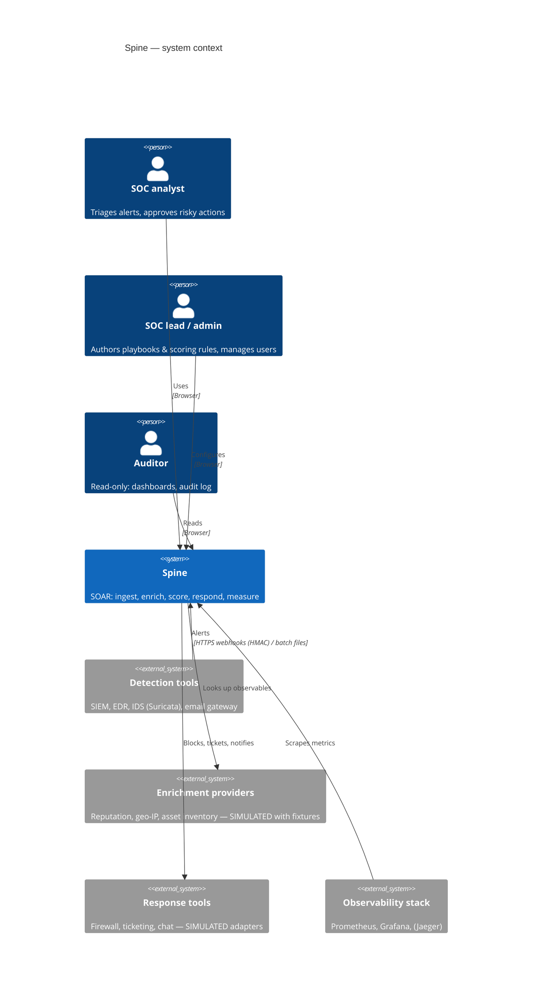
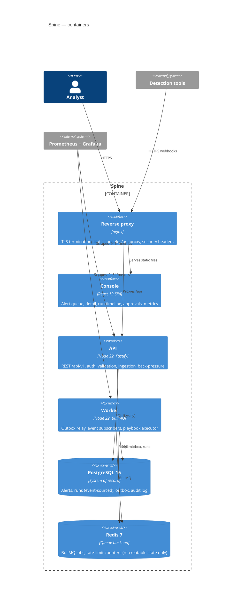
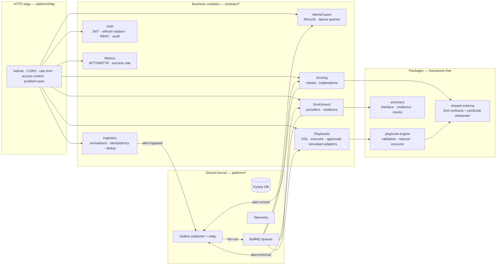

# Architecture overview

This page uses the [C4 model](https://c4model.com) (Context → Containers → Components)
to zoom in step by step. Diagrams are Mermaid, so they render on GitHub and are versioned with the code.

## Level 1 — System context

Who and what Spine talks to.



## Level 2 — Containers

The deployable/runnable units ([ADR-0002](../adr/0002-hexagonal-modular-monolith.md), [ADR-0008](../adr/0008-bullmq-redis-job-queue.md)).



**Why two processes from one codebase?** HTTP latency must not suffer when playbooks
are busy, and workers scale with queue depth, not with request rate. They share code,
migrations and the composition root (`apps/api/src/composition.ts`), and they differ only in
their entrypoint (`main.ts` vs `worker.ts`).

## Level 3 — Components (inside the API/worker)



Each module is internally hexagonal:

```
modules/<context>/
  domain/        pure rules and types (no framework imports — enforced by dependency-cruiser)
  application/   use cases + port interfaces (what it needs: repositories, gateways, clock)
  adapters/      http routes, postgres repositories, event handlers, external clients
  public-api.ts  the ONLY import surface for other modules
  index.ts       wires adapters into use cases and returns a SpineModule
```

## Cross-cutting views

- [Sequence diagrams](sequences.md): ingestion and playbook execution, step by step.
- [Data model](data-model.md): the ERD and why each index exists.
- [Event catalog](event-catalog.md): every domain event, producer, consumer.
- [API contract](api-contract.md) and the generated [OpenAPI document](openapi.json).

## Quality attributes and how the architecture serves them

| Attribute     | Mechanism                                                                   | Where                                                       |
| ------------- | --------------------------------------------------------------------------- | ----------------------------------------------------------- |
| Testability   | Pure domain, ports + in-memory fakes, injected clock/ids                    | every `domain/`, `platform/runtime.ts`                      |
| Reliability   | Transactional outbox, idempotent handlers, event-sourced runs, durable jobs | ADR-0009, 0010                                              |
| Resilience    | Timeouts, retry+jitter, circuit breakers, bulkheads, back-pressure          | ADR-0014, 0024                                              |
| Security      | Deny-by-default access policy, RBAC, validation at every edge, audit log    | ADR-0016, 0017, [threat model](../security/threat-model.md) |
| Observability | Correlation IDs across async hops, OTel metrics/traces, structured logs     | ADR-0019                                                    |
| Evolvability  | Module boundaries enforced in CI, versioned events and playbooks            | ADR-0020                                                    |
