# Data model

> Normative source: the SQL files in [`apps/api/migrations`](../../apps/api/migrations) and the
> Kysely row types in `apps/api/src/platform/db/schema.ts` ([ADR-0006](../adr/0006-kysely-and-plain-sql-migrations.md)).
> Each table belongs to **exactly one** module. Other modules never query it directly
> ([ADR-0002](../adr/0002-hexagonal-modular-monolith.md)). That's why some relationships below
> are "logical" (dotted lines, no foreign key across module boundaries).

## Entity–relationship diagram

```mermaid
erDiagram
    %% ---------- auth ----------
    users ||--o{ refresh_tokens : "has"
    users ||--o{ audit_log : "acts in"
    users {
        uuid id PK
        citext email UK
        text display_name
        text role "viewer|analyst|admin"
        text password_hash "argon2id"
        bool disabled
        timestamptz created_at
        timestamptz last_login_at
    }
    refresh_tokens {
        uuid id PK
        uuid user_id FK
        uuid family_id
        bytea token_hash UK "sha256"
        timestamptz expires_at
        timestamptz revoked_at
        uuid replaced_by
        timestamptz created_at
    }
    audit_log {
        bigint id PK
        timestamptz occurred_at
        uuid actor_id "nullable (anonymous/system)"
        text actor_type "user|system|webhook"
        text action "e.g. alert.update"
        text target_type
        text target_id
        int outcome_status
        text request_id
        inet ip
        text user_agent
        jsonb details
    }

    %% ---------- alerts/cases ----------
    cases ||--o{ alerts : "groups"
    alerts {
        uuid id PK
        text fingerprint "partial UK where open"
        text status "new|triaged|in_progress|resolved|false_positive"
        text title
        text category
        text source_vendor
        text source_product
        text source_severity
        int score "nullable until scored"
        text severity "derived from score"
        timestamptz scored_at "computedAt of the projected score (ADR-0038)"
        timestamptz occurred_at
        timestamptz received_at
        timestamptz last_seen_at
        timestamptz resolved_at
        int duplicate_count
        uuid assignee_id "logical → users"
        uuid case_id FK
        jsonb canonical "full CanonicalAlert"
        text_arr mitre_technique_ids "incl. parents of sub-techniques (ADR-0037)"
        text_arr mitre_tactic_ids
        timestamptz updated_at
    }
    cases {
        uuid id PK
        text title
        text description
        text status "open|in_progress|closed"
        uuid created_by "logical → users"
        timestamptz created_at
        timestamptz updated_at
    }

    %% ---------- ingestion ----------
    idempotency_keys {
        text scope PK
        text key PK
        bytea request_hash
        int response_status
        jsonb response_body
        timestamptz created_at
    }

    %% ---------- enrichment ----------
    alert_enrichments {
        uuid alert_id PK "logical → alerts"
        text provider PK
        text indicator_type PK
        text indicator_value PK
        text status "ok|not_found|error|timeout|circuit_open|rejected"
        text verdict
        jsonb data
        int duration_ms
        timestamptz fetched_at
    }

    %% ---------- scoring ----------
    alert_scores {
        uuid alert_id PK "logical → alerts"
        int ruleset_version PK
        int score
        text severity
        jsonb explanation "ScoreExplanation"
        timestamptz computed_at
    }

    %% ---------- playbooks ----------
    playbooks ||--o{ playbook_runs : "pinned version"
    playbook_runs ||--o{ playbook_run_events : "event-sourced"
    playbook_runs ||--o{ approvals : "gates"
    playbook_runs ||--o{ simulated_actions : "effects"
    playbooks {
        text id PK
        int version PK
        text name
        bool enabled "on latest version"
        jsonb definition
        text source "original YAML/JSON"
        uuid created_by
        timestamptz created_at
    }
    playbook_runs {
        uuid id PK
        text playbook_id FK
        int playbook_version FK
        uuid alert_id "logical → alerts"
        bool dry_run
        text status
        text current_step_id
        text trigger "auto|manual"
        uuid started_by
        int last_seq
        timestamptz created_at
        timestamptz started_at
        timestamptz finished_at
        bigint approval_wait_ms
    }
    playbook_run_events {
        uuid run_id PK
        int seq PK
        text type
        text step_id
        jsonb payload
        timestamptz occurred_at
    }
    approvals {
        uuid id PK
        uuid run_id FK
        text step_id
        text status "pending|approved|rejected|expired"
        text approver_role
        text prompt
        uuid decided_by
        text comment
        timestamptz requested_at
        timestamptz expires_at
        timestamptz decided_at
    }
    simulated_actions {
        uuid id PK
        text kind "firewall.block|firewall.unblock|ticket.create|chat.post"
        text idempotency_key UK
        uuid run_id
        text step_id
        jsonb request
        jsonb response
        bool dry_run
        timestamptz created_at
    }

    %% ---------- platform ----------
    domain_events {
        bigint id PK
        uuid event_id UK
        text type
        int version
        text aggregate_id
        jsonb payload
        text traceparent
        timestamptz occurred_at
        timestamptz dispatched_at
    }
    schema_migrations {
        text filename PK
        text checksum
        timestamptz applied_at
    }
```

## Key indexes and why

| Index                                                                                     | Why                                                                                |
| ----------------------------------------------------------------------------------------- | ---------------------------------------------------------------------------------- |
| `alerts (received_at DESC, id DESC)`                                                      | Default queue order + keyset pagination                                            |
| `alerts (score DESC NULLS LAST, id DESC)`                                                 | "Highest risk first" sort                                                          |
| `alerts (status)`, `(severity)` partial `WHERE status IN ('new','triaged','in_progress')` | Open-queue filters stay small                                                      |
| `UNIQUE alerts (fingerprint) WHERE status NOT IN ('resolved','false_positive')`           | Race-safe deduplication ([ADR-0012](../adr/0012-idempotency-and-deduplication.md)) |
| `alerts USING gin (title gin_trgm_ops)`                                                   | `?q=` free-text search                                                             |
| `alerts USING gin (mitre_technique_ids)`                                                  | ATT&CK filtering (`T1059` also matches `T1059.001`, ADR-0037)                      |
| `domain_events (id) WHERE dispatched_at IS NULL`                                          | The outbox relay scans only undispatched rows                                      |
| `playbook_runs (status) WHERE status NOT IN (terminal)`                                   | Startup reconciler finds runs to resume                                            |
| `approvals (status, requested_at)`                                                        | Approval inbox                                                                     |
| `refresh_tokens (family_id)`                                                              | Revoke a whole family on reuse                                                     |
| `audit_log (occurred_at DESC)`, `(actor_id, occurred_at DESC)`                            | Audit queries                                                                      |
| `audit_log (action text_pattern_ops, id DESC)` (migration `0101`)                         | `GET /audit-log?action=<prefix>` filter                                            |

## Mapping to ECS / OCSF

| Spine `CanonicalAlert`               | ECS                                       | OCSF (Detection Finding)                 |
| ------------------------------------ | ----------------------------------------- | ---------------------------------------- |
| `source.vendor` / `source.product`   | `observer.vendor` / `observer.product`    | `metadata.product.vendor_name` / `.name` |
| `source.sourceAlertId`               | `event.id`                                | `finding_info.uid`                       |
| `title`                              | `rule.name` / `message`                   | `finding_info.title`                     |
| `category`                           | `event.category`                          | `category_uid` / `finding_info.types`    |
| `severity`                           | `event.severity` (numeric)                | `severity_id`                            |
| `occurredAt`                         | `@timestamp`                              | `time`                                   |
| `host.hostname`, `host.ips`          | `host.hostname`, `host.ip`                | `device.hostname`, `device.ip`           |
| `user.name`, `user.email`            | `user.name`, `user.email`                 | `actor.user.name`, `.email_addr`         |
| `network.sourceIp` / `destinationIp` | `source.ip` / `destination.ip`            | `src_endpoint.ip` / `dst_endpoint.ip`    |
| `file.sha256`                        | `file.hash.sha256`                        | `file.hashes[]`                          |
| `url`                                | `url.full`                                | `url.url_string`                         |
| `mitre[]`                            | `threat.technique.id`, `threat.tactic.id` | `attacks[]`                              |
| `indicators[]`                       | `threat.indicator.*`                      | `observables[]`                          |
| `labels`                             | `labels`                                  | `unmapped`                               |
