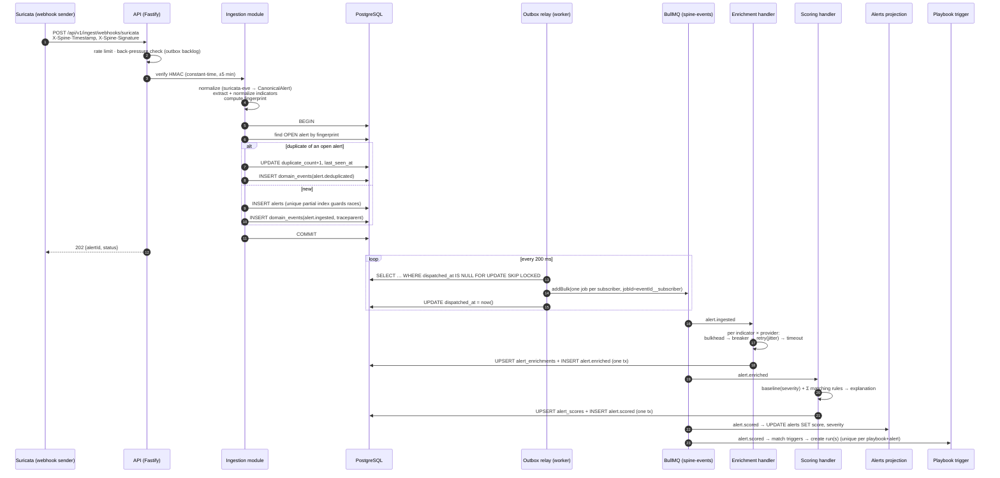
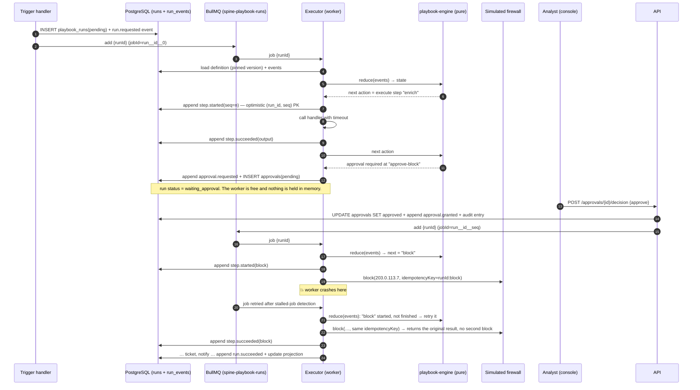

# Sequence diagrams

## 1. Ingestion: webhook → scored alert

**Failure walk-through** (a good exercise is to find the line for each):

- The API crashes after COMMIT but before responding → the client retries with the same
  `Idempotency-Key` → the stored response is replayed. No duplicate alert.
- The relay crashes after `addBulk` but before `UPDATE dispatched_at` → re-dispatch on
  restart → BullMQ ignores the duplicate job IDs.
- A reputation provider is down → its breaker opens → results with `circuit_open` →
  scoring proceeds, and the explanation lists the data gap.

## 2. Playbook execution with an approval gate and a crash

The key properties shown here: **state is never held in memory between steps**, every side
effect carries an **idempotency key derived from (runId, stepId)**, and the engine decides
the next action from the event log alone (a pure function, so it can be property-tested).
