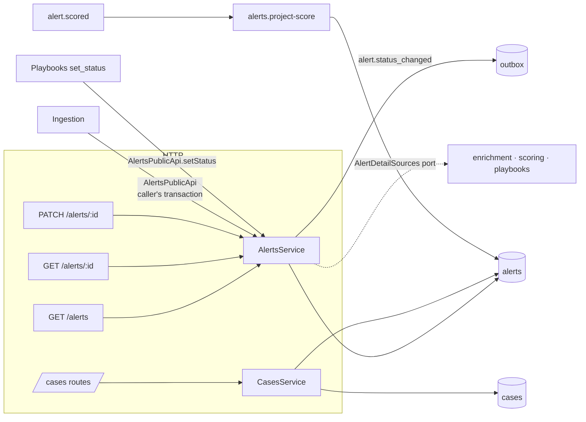

# Module: alerts

> **Status:** implemented in Phase 1 (`apps/api/src/modules/alerts`). Decisions:
> [ADR-0036](../adr/0036-alert-lifecycle-resolved-at.md) ·
> [0037](../adr/0037-alert-queue-query-semantics.md) ·
> [0038](../adr/0038-score-projection-ordering-guard.md), building on
> [ADR-0012](../adr/0012-idempotency-and-deduplication.md), [ADR-0024](../adr/0024-api-conventions.md)
> and [ADR-0026](../adr/0026-mttd-mttr-definitions.md).

## Purpose

This is where an analyst _works_. The Alerts/Cases module owns the alert record and its
lifecycle (`new → triaged → in_progress → resolved | false_positive`, with reopen), serves the
prioritized queue with filters that stay fast and stable while alerts keep arriving, shows one
alert with everything other modules learned about it, and groups related alerts into **cases**
(investigations). It also keeps the queue's `score`/`severity` columns in sync with Scoring.

## Design

| Layer          | Files                                                           | What it does                                                                                                 |
| -------------- | --------------------------------------------------------------- | ------------------------------------------------------------------------------------------------------------ |
| `domain/`      | `status-change.ts`                                              | `planStatusChange`: no-op / illegal / change, and the first-close `resolvedAt` rule                          |
|                | `mitre-index.ts`                                                | Filter ids (sub-technique + parent), `ILIKE` escaping                                                        |
| `application/` | `alerts-service.ts`                                             | Implements `AlertsPublicApi`; list, detail, triage update (one transaction with the event)                   |
|                | `cases-service.ts`, `project-score.ts`, `ports.ts`, `errors.ts` | Cases CRUD, the `alert.scored` subscriber, repository and `AlertDetailSources` ports, `OpenAlertExistsError` |
| `adapters/`    | `postgres/alert-repository.ts`, `case-repository.ts`, `rows.ts` | Kysely queries, keyset predicates, row ↔ `Alert`/`AlertSummary`/`Case` mapping                              |
|                | `http/routes.ts`                                                | `/alerts` and `/cases` routes with Zod schemas from `@spine/shared-schema`                                   |

Storage: the `canonical` jsonb column keeps what the source said (the prepared canonical
alert); lifecycle fields assigned by Spine (`status`, counters, timestamps, `score`,
`case_id`…) are real columns so they can be indexed and updated in place. List queries never
select the whole `canonical` (it can hold 64 KiB of raw payload), only `canonical -> 'mitre'`.

## Public API

`AlertsPublicApi` (`public-api.ts`):

| Method                                    | Used by                  | Notes                                                                                       |
| ----------------------------------------- | ------------------------ | ------------------------------------------------------------------------------------------- |
| `get(alertId)`                            | playbooks, enrichment, … | Full `Alert` snapshot or null                                                               |
| `setStatus(alertId, to, actorId \| null)` | playbooks (`set_status`) | Validated; same status = no-op; `409` on illegal transition; emits `alert.status_changed`   |
| `findOpenByFingerprint(trx, fingerprint)` | ingestion                | Locks the open alert's row (`FOR UPDATE`) until the caller's transaction ends               |
| `recordDuplicate(trx, alertId, seenAt)`   | ingestion                | `duplicate_count + 1`, `last_seen_at = greatest(old, seenAt)`                               |
| `create(trx, alert)`                      | ingestion                | Throws `OpenAlertExistsError` (exported) when the open-fingerprint index rejects the insert |

HTTP (base `/api/v1`):

| Endpoint            | Auth    | Notes                                                                                                                                                                                                      |
| ------------------- | ------- | ---------------------------------------------------------------------------------------------------------------------------------------------------------------------------------------------------------- |
| `GET /alerts`       | viewer  | `status[]`, `severity[]` (effective), `category`, `minScore`, `maxScore`, `source` (vendor or product), `q`, `from`, `to`, `assigneeId`, `technique`, `sort=receivedAt\|score`, `order`, `limit`, `cursor` |
| `GET /alerts/:id`   | viewer  | `AlertDetail = {summary, alert, enrichments, score, runs}`                                                                                                                                                 |
| `PATCH /alerts/:id` | analyst | `{status?, assigneeId?, caseId?}` → `AlertSummary`; `409` illegal transition or reopen collision; `422` unknown case                                                                                       |
| `GET /cases`        | viewer  | `?status&limit&cursor`, newest first                                                                                                                                                                       |
| `POST /cases`       | analyst | `{title, description?, alertIds[]}` → `201 Case`; `422` unknown alert ids                                                                                                                                  |
| `GET /cases/:id`    | viewer  | `Case` + `alerts: AlertSummary[]`                                                                                                                                                                          |
| `PATCH /cases/:id`  | analyst | `{status?, title?, description?, addAlertIds?, removeAlertIds?}`                                                                                                                                           |

Events: emits `alert.status_changed`; consumes `alert.scored` (subscriber `alerts.project-score`).
The detail view reads other modules' data through the `AlertDetailSources` port, wired in
`composition.ts` (Phase 1: a placeholder returning empty data, marked `// INTEGRATION`).

## Invariants

| Invariant                                                                                      | Proved by                                                                                                                                                         |
| ---------------------------------------------------------------------------------------------- | ----------------------------------------------------------------------------------------------------------------------------------------------------------------- |
| Only transitions in `ALERT_STATUS_TRANSITIONS` happen; setting the current status is a no-op   | `status-change.test.ts` › _property: agrees with the shared transition table…_; `alerts.test.ts` › _answers 409…_, _treats setting the current status as a no-op_ |
| `resolvedAt` is the first close and never moves (reopen, re-close)                             | `status-change.test.ts`, `alerts.test.ts` › _keeps the FIRST resolvedAt across reopen and re-close_                                                               |
| Every real transition emits exactly one `alert.status_changed` with the actor, atomically      | `alerts.test.ts` › _applies legal transitions and emits alert.status_changed with the actor_                                                                      |
| A reopen never creates a second open alert for one fingerprint                                 | `alerts.test.ts` › _refuses to reopen when a newer open alert has the same fingerprint (409)_                                                                     |
| Keyset paging returns every row exactly once, for both sorts and both orders, NULL scores last | `alerts.test.ts` › _walks score DESC NULLS LAST…_, _walks score ASC…_, _walks receivedAt ASC…_                                                                    |
| Paging by `receivedAt` is stable while new alerts arrive                                       | `alerts.test.ts` › _stays stable while new alerts arrive_                                                                                                         |
| The score projection is idempotent and never applies an older score over a newer one           | `alerts.test.ts` › _is idempotent and ignores an older score delivered late_                                                                                      |
| An alert belongs to at most one case (the link is `alerts.case_id`)                            | schema (single FK column); `alerts.test.ts` › _updates fields and links/unlinks alerts_                                                                           |

## Failure modes

| Failure                                    | Behaviour                                                                            | How it's tested                                                       |
| ------------------------------------------ | ------------------------------------------------------------------------------------ | --------------------------------------------------------------------- |
| Two analysts change one alert at once      | Row lock serializes them; the second transition is validated on fresh state          | by construction (`SELECT … FOR UPDATE`)                               |
| Illegal transition / reopen collision      | `409` problem, nothing written                                                       | _answers 409…_, _refuses to reopen…_                                  |
| `alert.scored` redelivered or reordered    | Same values re-written / stale score ignored                                         | _is idempotent and ignores an older score…_                           |
| Scoring is down                            | Alerts stay unscored: listed last by score, still found by severity filter           | _filters by effective severity…_                                      |
| Malformed or foreign cursor                | `400 validation-error`                                                               | _rejects invalid queries…_, _refuses a cursor from another sort mode_ |
| Unknown alert/case ids                     | `404` (path) or `422` (ids in a body)                                                | _answers 404…_, _refuses unknown alert ids (422)_                     |
| Score changes while someone pages by score | The alert can move across the cursor (seen twice or skipped). Documented in ADR-0037 | —                                                                     |

## How to extend it

**Add a list filter** (e.g. `tactic`):

1. Add the optional field to `AlertListQuerySchema` in `packages/shared-schema/src/api.ts` (additive).
2. In `adapters/postgres/alert-repository.ts` › `applyFilters`, add a `where` clause. For
   arrays, use `@>` so the GIN index applies (`mitre_tactic_ids` is already stored).
3. Add a case to `alerts.test.ts` › _GET /alerts filters_ and run `pnpm openapi:generate`.

## How to learn this module

1. Read `domain/status-change.ts` and its test: the whole lifecycle in 40 lines.
2. Read ADR-0037, then `scoreKeyset` in `alert-repository.ts`. Run
   `pnpm --filter @spine/api test:integration -- alerts` and read the pagination tests.
3. Read `application/alerts-service.ts` › `update` to see a lock, a domain decision, a write
   and an outbox event in one transaction.

### Exercises

1. **NULL trap.** Replace `scoreKeyset` with `(score, id) < (k, id)` (a row comparison) and run
   the alerts integration tests. Which tests fail and why exactly? What happens to the first
   unscored alert?
2. **Effective severity.** An alert came in as `high` and was scored 15. Which `severity`
   filter finds it, and what does the summary show for `sourceSeverity` and `severity`?
3. **MTTR query.** Using only the `alerts` table, write the SQL for MTTR over alerts received in
   `[from, to)` per ADR-0026, respecting ADR-0036. Why do you need `status` and not just `resolved_at`?
4. **Case closing.** Product asks: "closing a case should resolve all its alerts". Sketch the
   change. Which public API would you call, in which transaction, and what about alerts that
   are already closed?

Solutions: [exercises/alerts-solutions.md](exercises/alerts-solutions.md) (try first!)
