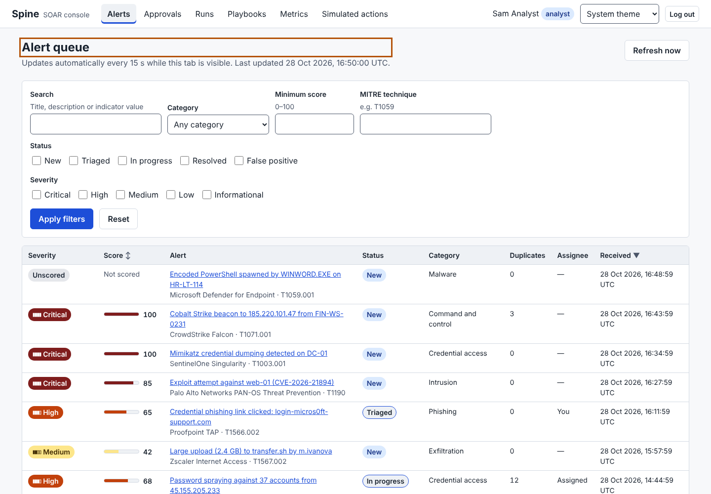
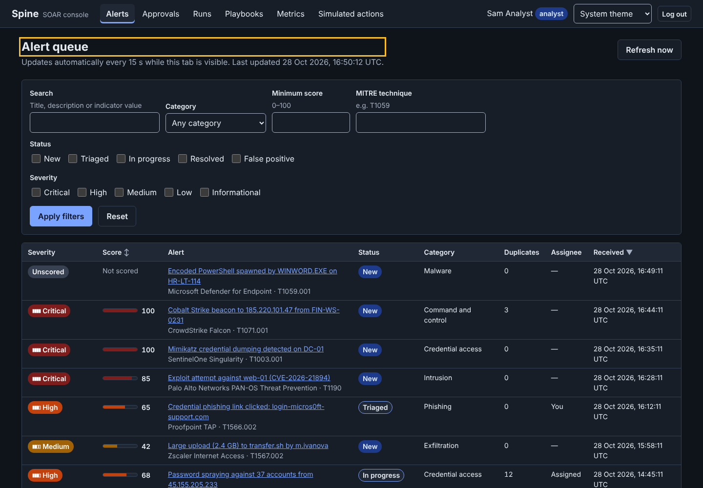
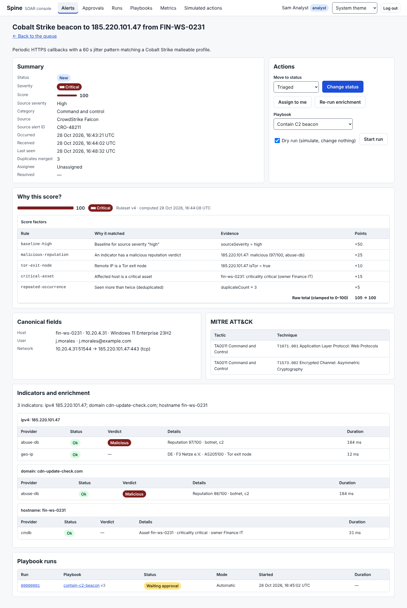
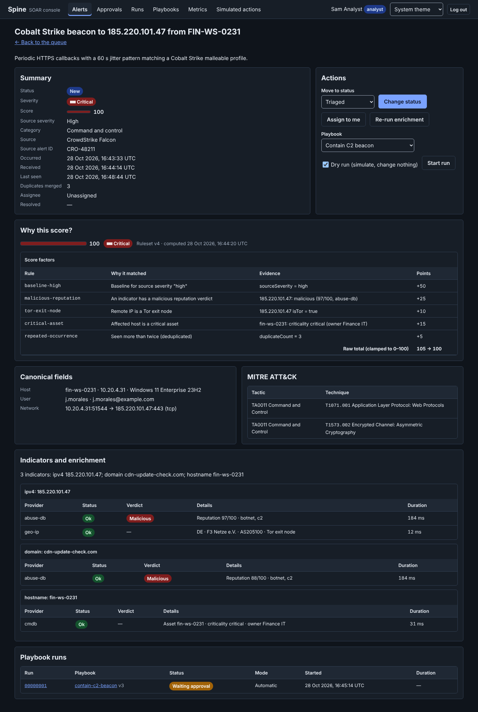
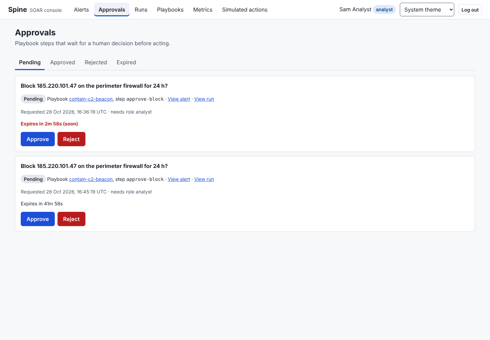
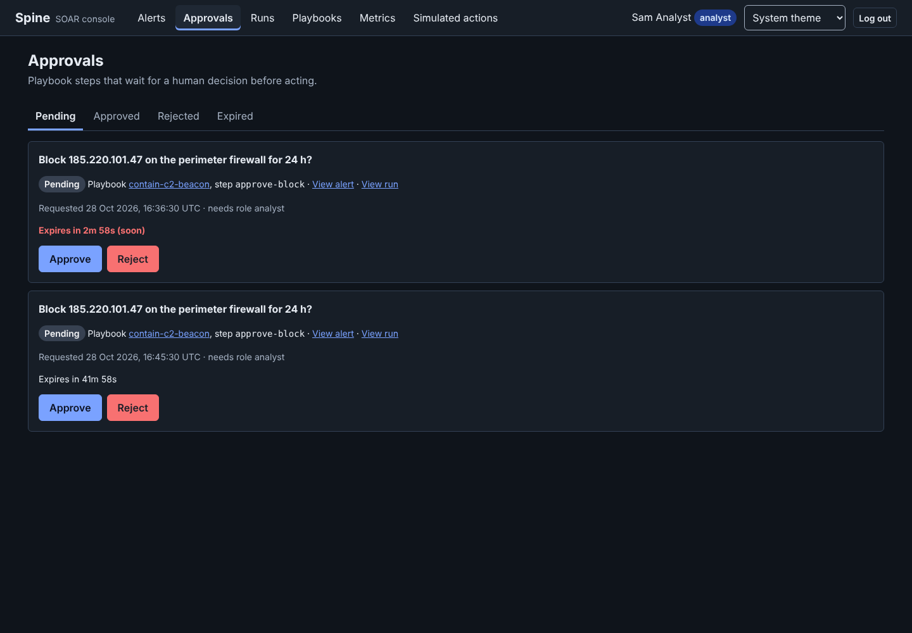
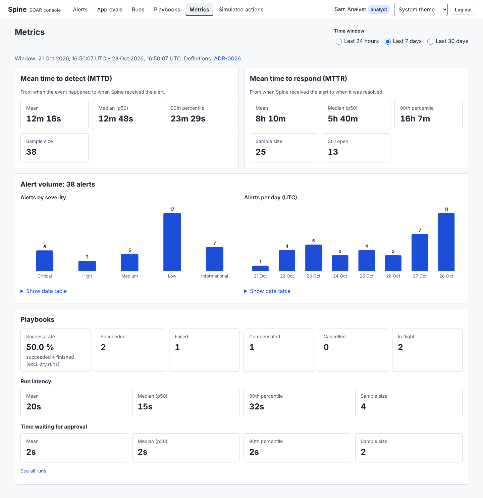
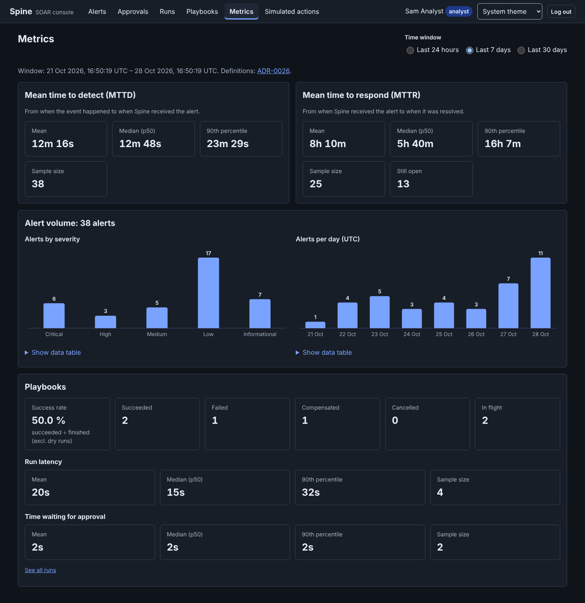
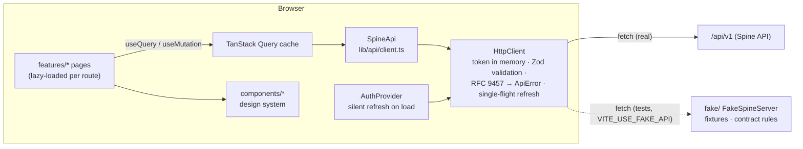

# Module: console

> **Status:** implemented (Phase 1). Built against the v1 contract with a typed fake API; the
> lead wires it to the real backend during integration. Code: [`apps/console`](../../apps/console).

## Purpose

The console is where analysts spend their shift. It turns the API into a triage workflow: a
prioritized, live alert queue; an alert page that explains **why** an alert scored what it did
and what enrichment found; one-click (but confirmed) approvals for the playbook steps that wait
for a human; run timelines that show what automation did; and the metrics a SOC lead reports
(MTTD, MTTR, playbook success). It hides what a role can't do, but the server enforces every
permission ([ADR-0017](../adr/0017-rbac-model.md)).

| Light                                                                | Dark                                                               |
| -------------------------------------------------------------------- | ------------------------------------------------------------------ |
|  |  |
|      |      |
|            |            |
|                |                |

## Design

React 19 + Vite + TanStack Query + React Router 7, no UI kit ([ADR-0023](../adr/0023-console-react-vite-no-ui-kit.md)).
No runtime dependency was added: React, React Router, TanStack Query and Zod only.



**Layers** (`apps/console/src`):

| Folder        | Responsibility                                                                                                                                                                                                                                                                      |
| ------------- | ----------------------------------------------------------------------------------------------------------------------------------------------------------------------------------------------------------------------------------------------------------------------------------- |
| `lib/api/`    | `HttpClient` (transport, auth, validation, errors), `createSpineApi` (one typed function per endpoint), `ApiProvider`, keys                                                                                                                                                         |
| `lib/auth/`   | `AuthProvider`, `useAuth`, `useCan(role)`, `RequireAuth`, `RequireRole`, `safeNextPath`                                                                                                                                                                                             |
| `lib/`        | theme (localStorage, no secrets), formatting (UTC everywhere), `useDocumentTitle`, `useNow`                                                                                                                                                                                         |
| `components/` | the design system: Button, IconButton, Badge/SeverityBadge/StatusBadge, Table/SortableHeader, Dialog, Tabs, Field/TextInput/Select/Textarea/CheckboxGroup, Toast, Timeline, EmptyState, ErrorState, Callout, Spinner, LoadMore, ScoreBar, KeyValue, PageHeader, QueryView, BarChart |
| `features/`   | one folder per area: alerts, runs, approvals, playbooks, metrics, simulated, admin, auth; plus the 404 page                                                                                                                                                                         |
| `app/`        | providers, routes (`React.lazy` per page), the shell (skip link, banner, nav, `<main>`)                                                                                                                                                                                             |
| `fake/`       | the in-browser fake API and fixtures, shared by tests and the demo ([ADR-0071](../adr/0071-console-in-browser-fake-api.md))                                                                                                                                                         |

**Key decisions:** response validation and the refresh dance ([ADR-0070](../adr/0070-console-api-client-validation-and-refresh.md)),
the fake API ([ADR-0071](../adr/0071-console-in-browser-fake-api.md)), styling ([ADR-0072](../adr/0072-console-plain-css-with-prefixed-classes.md)),
charts ([ADR-0073](../adr/0073-console-hand-built-svg-charts.md)), freshness and optimistic approvals ([ADR-0074](../adr/0074-console-data-freshness-and-optimistic-updates.md)).

**Auth flow.** The access token is a private field of the `HttpClient` (never Web Storage).
On page load `AuthProvider` calls `POST /auth/refresh` (`credentials: 'include'`, `X-Spine-CSRF: 1`):
the HttpOnly cookie turns into a fresh access token, so a reload keeps the session. On any 401,
the client joins a single in-flight refresh and retries once; if the refresh fails the session
is cleared, the query cache is wiped (no data leaks to the next user of the tab) and
`RequireAuth` sends the user to `/login?next=…` (`next` must be a same-origin path: no open redirect).

**Accessibility (WCAG 2.2 AA).** Semantic HTML first (real tables with captions and `scope`,
`<dialog>` for modals, native selects/checkboxes/radios, `<dl>` for key/value), visible labels
wired with `aria-describedby`/`aria-invalid`, severity and status always as text, a skip link,
one `<main>`, per-route document titles, focus moved to the `<h1>` after client-side
navigation, a polite live region for toasts, `role="meter"` score bars with the number as text,
charts with a text summary and a data table. axe-core runs in every page test (jsdom) and,
with colour contrast, in a real browser in the screenshot script.

## Public API

The console is an application, not a library: other modules don't import it. Its "API" is the
set of routes it serves and the backend endpoints it relies on.

**Routes:** `/login`, `/alerts`, `/alerts/:id`, `/runs`, `/runs/:id`, `/approvals`, `/playbooks`,
`/playbooks/:id`, `/metrics`, `/simulated-actions`, `/admin/users` (admin), `/admin/audit-log`
(admin), and a 404 for anything else.

**Backend endpoints and fields the console relies on** (all under `/api/v1`, all responses
parsed with the named `@spine/shared-schema` schema):

| Endpoint                                        | Request the console sends                                                                                                                                    | Response schema / codes it handles                                                                                                                                        |
| ----------------------------------------------- | ------------------------------------------------------------------------------------------------------------------------------------------------------------ | ------------------------------------------------------------------------------------------------------------------------------------------------------------------------- |
| `POST /auth/login`                              | `{email, password}`, `credentials: include`                                                                                                                  | `TokenResponseSchema`; 401 (generic message), 429                                                                                                                         |
| `POST /auth/refresh`                            | no body, `credentials: include`, `X-Spine-CSRF: 1`                                                                                                           | `TokenResponseSchema`; any non-2xx = logged out                                                                                                                           |
| `POST /auth/logout`                             | no body, `credentials: include`, `X-Spine-CSRF: 1`                                                                                                           | 204 (errors ignored, local logout always happens)                                                                                                                         |
| `GET /alerts`                                   | `status`, `severity` (**repeated keys** for multi-select), `minScore`, `category`, `q`, `technique`, `sort=receivedAt\|score`, `order`, `cursor`, `limit=25` | `pageSchema(AlertSummarySchema)`                                                                                                                                          |
| `GET /alerts/:id`                               | —                                                                                                                                                            | `AlertDetailSchema` (`summary`, `alert`, `enrichments`, `score`, `runs`)                                                                                                  |
| `PATCH /alerts/:id`                             | `{status}` or `{assigneeId}` (`null` to unassign)                                                                                                            | `AlertSummarySchema`; 409 on illegal transition                                                                                                                           |
| `POST /alerts/:id/enrich`                       | —                                                                                                                                                            | 202, body ignored                                                                                                                                                         |
| `GET /playbooks`                                | —                                                                                                                                                            | `z.array(PlaybookSummarySchema)`                                                                                                                                          |
| `GET /playbooks/:id`                            | —                                                                                                                                                            | `PlaybookRecordSchema` (uses `definition`, `source`, `enabled`)                                                                                                           |
| `POST /playbooks/validate`                      | `{source, format: yaml\|json}`                                                                                                                               | `{valid: true, definition}`; 422 with `errors[]` (path + message)                                                                                                         |
| `PATCH /playbooks/:id`                          | `{enabled}`                                                                                                                                                  | `PlaybookSummarySchema`                                                                                                                                                   |
| `POST /playbooks/:id/runs`                      | `{alertId, dryRun}`                                                                                                                                          | 202 `{runId}`                                                                                                                                                             |
| `GET /runs`                                     | `status`, `playbookId`, `cursor`, `limit=25`                                                                                                                 | `pageSchema(RunSummarySchema)`                                                                                                                                            |
| `GET /runs/:id`                                 | —                                                                                                                                                            | `RunDetailSchema`; reads event payload keys `attempt`, `error`, `continued`, `taken`, `delayMs`, `reason`, `prompt`, `decidedBy`, `action`, `by`, `dryRun` (all optional) |
| `POST /runs/:id/cancel`                         | —                                                                                                                                                            | 202; 409 when already terminal                                                                                                                                            |
| `GET /approvals`                                | `status`, `limit=100`                                                                                                                                        | `pageSchema(ApprovalSchema)`; expects pending ones ordered by `expiresAt` asc                                                                                             |
| `POST /approvals/:id/decision`                  | `{decision: approve\|reject, comment?}`                                                                                                                      | `ApprovalSchema`; 409 if decided/expired                                                                                                                                  |
| `GET /simulated-actions`                        | `kind`, `cursor`, `limit=50`                                                                                                                                 | `pageSchema(SimulatedActionSchema)`                                                                                                                                       |
| `GET /metrics/summary`                          | `from`, `to` (ISO, computed from the 24 h / 7 d / 30 d selector)                                                                                             | `MetricsSummarySchema`                                                                                                                                                    |
| `GET /users`, `POST /users`, `PATCH /users/:id` | `limit=200`; `CreateUserRequest`; `{role}` or `{disabled}`                                                                                                   | `pageSchema(UserSchema)`, `UserSchema`; 400 `errors[]`, 409                                                                                                               |
| `GET /audit-log`                                | `actorId`, `action`, `from`, `to`, `cursor`, `limit=50`                                                                                                      | `pageSchema(AuditEntrySchema)`                                                                                                                                            |

The client also has typed functions for `GET /auth/me`, `/cases`, `/enrichment/providers` and
`/scoring/ruleset`, unused by pages yet.

**Contract notes for integration** (no contract change was made):

- `StartRunResponseSchema` (`{runId}`) and `ValidatePlaybookResponseSchema` (`{valid: true, definition}`)
  are defined locally in `lib/api/client.ts` because `@spine/shared-schema` doesn't export them;
  the playbooks module may want to move them into the shared package.
- `Approval.prompt` is displayed as-is: the server should render `{{…}}` templates before returning it.
- `technique` is accepted by `AlertListQuerySchema` but missing from the contract page's query list.

## Invariants

| Invariant                                                                                   | Proven by                                                                                                                                                                                        |
| ------------------------------------------------------------------------------------------- | ------------------------------------------------------------------------------------------------------------------------------------------------------------------------------------------------ |
| N concurrent 401s cause exactly one `POST /auth/refresh`; each request is retried once.     | `lib/api/http.test.ts` "de-duplicates concurrent 401s…", "does not retry more than once…"; `app/App.test.tsx` "refreshes once when several requests hit 401"                                     |
| A late 401 for a request sent with an already-replaced token does not refresh again.        | `http.test.ts` "reuses a token refreshed by another request…"                                                                                                                                    |
| A failed refresh logs the user out; tokens are never written to Web Storage.                | `http.test.ts` "logs out…", "never writes tokens to Web Storage"; `App.test.tsx` "logs out when the refresh fails"                                                                               |
| Every response is validated against the shared schema; drift raises `ContractError`.        | `http.test.ts` "throws a ContractError…"; `fake/fake.test.ts` "every endpoint … schema-valid"                                                                                                    |
| The status menu offers exactly the contract's allowed transitions.                          | `AlertDetailPage.test.tsx` "offers only the allowed status transitions", "matches the contract state machine"                                                                                    |
| Actions are hidden from roles that can't perform them; admin routes are guarded by URL too. | `App.test.tsx` "shows admin navigation to admins only", "guards admin routes…"; `AlertDetailPage.test.tsx` "hides every action from viewers"; `ApprovalsPage.test.tsx` "viewers … cannot decide" |
| Alert-queue filters round-trip through the URL.                                             | `AlertQueuePage.test.tsx` "round-trips through search params", "applies filters to the URL…", "reads filters from the URL on load"                                                               |
| A 409 on an approval decision rolls back the optimistic removal.                            | `ApprovalsPage.test.tsx` "rolls back the optimistic update on 409…"                                                                                                                              |
| Every page has no axe violations.                                                           | the `expectNoAxeViolations` calls in each page test; `scripts/console-screenshots.mjs` (real browser, with contrast)                                                                             |

## Failure modes

| Failure                                   | Behaviour                                                                                  | How it's tested                                                          |
| ----------------------------------------- | ------------------------------------------------------------------------------------------ | ------------------------------------------------------------------------ |
| Access token expired                      | One refresh, transparent retry                                                             | `http.test.ts`, `App.test.tsx`                                           |
| Refresh token revoked / expired           | Session cleared, cache wiped, redirect to login with `next`                                | `App.test.tsx` "logs out when the refresh fails"                         |
| API unreachable                           | `NetworkError`, "server could not be reached", retry button; logout still succeeds locally | `http.test.ts` "wraps transport failures…", "logout clears the session…" |
| Background refresh fails                  | Last data stays visible with a "could not refresh" notice                                  | `components.test.tsx` QueryView; `ApprovalsPage.test.tsx` rollback test  |
| Initial load fails                        | Error state with "Try again"                                                               | `AlertQueuePage.test.tsx` "shows an error with a working retry"          |
| Backend response doesn't match the schema | `ContractError`, user sees "data the console does not understand"                          | `http.test.ts`                                                           |
| Conflicting edit (409)                    | Toast explains; data refetched (approvals: rollback first)                                 | `AlertDetailPage.test.tsx`, `ApprovalsPage.test.tsx`                     |
| Unknown resource (404)                    | Error state with the server's message                                                      | "shows a not-found error…" tests                                         |
| Off-site `?next=` after login             | Ignored, goes to `/alerts`                                                                 | `App.test.tsx` "ignores off-site return paths"                           |

## How to extend it

**Add a page** (e.g. cases):

1. Add the endpoint function to `createSpineApi` in `lib/api/client.ts`, with the shared schema.
2. Add a query key in `lib/api/queryKeys.ts`.
3. Implement the route in `fake/routes.ts` (and fixtures if needed), enforcing the same access level as the contract.
4. Create `features/cases/CasesPage.tsx` with a default export; start with `<PageHeader>` and wrap data in `<QueryView>` so loading, error, empty and success are all handled.
5. Register it in `app/routes.tsx` with `lazy(() => import(...))` and add a nav entry in `app/Shell.tsx`.
6. Write a page test with `renderApp('/cases', 'analyst')`, include `expectNoAxeViolations`.

**Run the standalone demo** (no backend):

```bash
VITE_USE_FAKE_API=true pnpm --filter @spine/console dev   # http://localhost:5173
# log in as ada@spine.local (admin), sam@spine.local (analyst) or val@spine.local (viewer)
# password: spine-demo-password  (fake accounts; they exist only in the browser)
```

**Regenerate the screenshots** (Playwright with Chromium installed globally):

```bash
VITE_USE_FAKE_API=true pnpm --filter @spine/console exec vite build --outDir dist/demo
pnpm --filter @spine/console exec vite preview --outDir dist/demo --port 5199 &
node scripts/console-screenshots.mjs http://localhost:5199   # also runs axe with contrast
```

## How to learn this module

1. Read `lib/api/http.ts` top to bottom, then its test `lib/api/http.test.ts`. The test's
   `scriptedBackend` holds refreshes behind a gate so you can _see_ concurrency.
2. Run `pnpm --filter @spine/console test -- src/lib/api` and change `refresh()` to drop the
   `??=` (always start a new refresh). Watch the concurrency test fail, and read why in ADR-0070.
3. Start the demo, open the browser devtools Network tab, wait 15 s on `/alerts`, switch tabs,
   and see polling pause. Then open an alert, start a dry run, and watch the timeline fill in.
4. Read `features/approvals/ApprovalsPage.tsx` `useDecide()` next to ADR-0074.
5. Tab through any page with the keyboard only; then run the screenshot script to see axe in a real browser.

### Exercises

1. **Off-by-one refresh.** Write a test proving that a request which receives a 401 _after_
   another request has already refreshed does not trigger a second refresh. Then explain which
   line of `HttpClient` makes it pass.
2. **Shareable sort.** Add "sort by last seen" to the alert queue. The sort must be in the URL
   and show `aria-sort` on its header. What would the backend need?
3. **Pending count in the nav.** Show "Approvals (2)" in the navigation. Keep it accessible
   (the count must be part of the link's name) and don't double the polling load.
4. **Expired while open.** An approval expires while its dialog is open. What happens today when
   the analyst confirms? Write the test, then improve the UX.
5. **Keyboard trap check.** Our jsdom dialog polyfill can't prove the focus trap. Write a
   Playwright check that tabs through an open dialog and asserts focus never leaves it.

Solutions: [exercises/console-solutions.md](exercises/console-solutions.md) (try first!)
