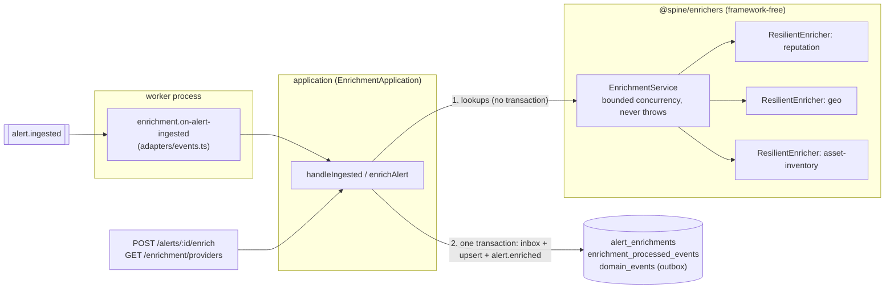

# Module: enrichment

> **Status:** implemented (Phase 1). Code: [`apps/api/src/modules/enrichment`](../../apps/api/src/modules/enrichment)
> and the framework-free package [`packages/enrichers`](../../packages/enrichers/README.md).

## Purpose

An alert says "host `dc01` talked to `203.0.113.66`". An analyst's first five minutes go
into asking: is that IP known-bad? Where is it? What is `dc01`, and who owns it? Enrichment
does that legwork automatically for every new alert. It asks every **provider**
(threat-intel reputation, geo-IP, asset inventory) about every **indicator**, stores the
answers, and hands them to [scoring](scoring.md).

Providers are slow and unreliable in real life. The module's second job is to make sure a
bad provider **never** slows down or breaks the pipeline: it degrades to "we don't know",
and the score explanation says so ([ADR-0014](../adr/0014-hand-written-resilience-primitives.md)).

## Design



**Layers** (hexagonal, [ADR-0002](../adr/0002-hexagonal-modular-monolith.md)):

| Layer       | File(s)                                                 | Responsibility                                                              |
| ----------- | ------------------------------------------------------- | --------------------------------------------------------------------------- |
| package     | `packages/enrichers`                                    | `Enricher` port, resilience primitives, mock providers, `EnrichmentService` |
| domain      | `domain/circuit-gauge.ts`                               | Encoding breaker states for the gauge (pure)                                |
| application | `application/ports.ts`, `application/enrichment-app.ts` | Use cases; ports `AlertEnricher`, `EnrichmentRepository`, `AlertLookup`     |
| adapters    | `adapters/postgres.ts`                                  | Upsert with merge rules (ADR-0041), inbox (ADR-0040), read-back             |
|             | `adapters/events.ts`                                    | Subscriber `enrichment.on-alert-ingested`                                   |
|             | `adapters/http.ts`                                      | Routes                                                                      |
|             | `adapters/providers.ts`                                 | Builds the provider set from config                                         |
|             | `adapters/metrics.ts`                                   | OpenTelemetry instruments                                                   |
| composition | `index.ts`                                              | Wires everything; `createEnrichmentModule(deps, { alertLookup })`           |

**The two-phase handler** is the key design point. Provider lookups can take seconds
(timeouts × retries), so they run **before** the transaction. The transaction then does
only fast work: insert the event id into the inbox, upsert the results, read back the
merged set, publish `alert.enriched`. A transaction is never held open while waiting on a
provider. See [ADR-0040](../adr/0040-enrichment-idempotent-receiver.md).

**The resilience stack** wraps each provider, outermost first: bulkhead → circuit breaker →
retry with full jitter → per-attempt timeout. The [package README](../../packages/enrichers/README.md)
has the diagrams. The defaults and exact breaker semantics are in
[ADR-0044](../adr/0044-resilience-defaults-and-breaker-semantics.md).

**Mock providers** answer from JSON fixtures, with seeded fault injection
([ADR-0045](../adr/0045-deterministic-mock-providers.md)):

| Provider          | Supports                                               | Returns                                                |
| ----------------- | ------------------------------------------------------ | ------------------------------------------------------ |
| `reputation`      | public `ipv4`/`ipv6`, `domain`, `url`, `sha256`, `md5` | `{score 0–100, verdict, tags[], firstSeen?}` + verdict |
| `geo`             | public `ipv4`/`ipv6`                                   | `{country, city, asn, org, isTor}`                     |
| `asset-inventory` | `hostname` (FQDN or short name), private `ipv4`/`ipv6` | `{hostname, owner, businessUnit, criticality, tags}`   |

Lookup targets are the alert's indicators **plus its host** (`host.hostname`, `host.ips`),
normalized (lower-cased where case doesn't matter) and de-duplicated.

## Public API

`EnrichmentPublicApi` ([public-api.ts](../../apps/api/src/modules/enrichment/public-api.ts)):

| Member                                      | Behaviour                                                                                                                             |
| ------------------------------------------- | ------------------------------------------------------------------------------------------------------------------------------------- |
| `getForAlert(alertId)`                      | Stored results, ordered by indicator type, value, provider. `[]` if never enriched.                                                   |
| `enrichAlert(alert, {providers?, signal?})` | Runs lookups now, persists, publishes `alert.enriched`, resolves with the **merged** stored set. Never rejects because of a provider. |
| `providerStatus()`                          | `ProviderStatus[]`: `{name, supports, circuit, inFlight, queued}` for **this process**.                                               |

**Events.** Consumes `alert.ingested` (subscriber `enrichment.on-alert-ingested`).
Publishes `alert.enriched` `{alert, enrichments}`, where `enrichments` is the merged stored set,
failures included.

**HTTP** (under `/api/v1`):

| Method | Path                    | Role    | Response                                                              |
| ------ | ----------------------- | ------- | --------------------------------------------------------------------- |
| GET    | `/enrichment/providers` | viewer  | `200 ProviderStatus[]`                                                |
| POST   | `/alerts/:id/enrich`    | analyst | `202 {alertId, enrichments}`; `404` unknown alert; `400` malformed id |

`POST /alerts/:id/enrich` needs the alert snapshot, which belongs to the alerts module. It
goes through the `AlertLookup` port. Until the alerts module is integrated, composition
wires a placeholder that finds nothing (so the route answers 404), marked `// INTEGRATION`.

**Configuration** (`.env.example`): `ENRICHMENT_LATENCY_MS` (30), `ENRICHMENT_FAILURE_RATE` (0),
`ENRICHMENT_SEED` (42), `ENRICHMENT_TIMEOUT_MS` (1000), `ENRICHMENT_MAX_ATTEMPTS` (3),
`ENRICHMENT_CONCURRENCY` (8).

**Metrics:** `spine_enrichment_duration_seconds{provider,status}` (histogram, one sample
per lookup, all attempts included) and `spine_enrichment_circuit_state{provider}` (gauge:
0 closed, 1 half_open, 2 open; set at startup and on every transition).

## Invariants

| Invariant                                                                                                | Proven by                                                                                                                      |
| -------------------------------------------------------------------------------------------------------- | ------------------------------------------------------------------------------------------------------------------------------ |
| A provider failure never makes enrichment throw; it becomes a result with a failed status                | `packages/enrichers/test/enrichment-service.test.ts` › _maps outcomes and failures…_; pipeline test _with every provider down_ |
| One `alert.ingested` event produces at most one `alert.enriched`, even under concurrent redelivery       | `test/integration/enrichment.test.ts` › _is idempotent_                                                                        |
| A failed lookup never replaces a stored success; an older result never replaces a newer one              | `enrichment.test.ts` › _records failures as results…_ and _a newer result replaces an older one…_                              |
| Upserts, inbox row and `alert.enriched` commit together or not at all                                    | one `db.transaction()` in `PostgresEnrichmentRepository`; outbox semantics: `platform.test.ts`                                 |
| A bulkhead never runs more than `maxConcurrent` calls and settles every call                             | `bulkhead.test.ts` › _property: never exceeds…_                                                                                |
| An open breaker never calls the provider before its cooldown has elapsed                                 | `circuit-breaker.test.ts` › _property: never lets a call through while open…_                                                  |
| Retry delays lie in `[0, min(cap, base·2^i)]`; attempts ≤ `maxAttempts`; no retry after abort            | `retry.test.ts` › _property…_, _never starts another attempt after the caller aborts…_                                         |
| A timeout settles exactly once, aborts the provider's signal with its reason, and leaves no timer behind | `timeout.test.ts` › _property: settles exactly once…_                                                                          |
| Concurrency for one alert never exceeds `ENRICHMENT_CONCURRENCY`                                         | `enrichment-service.test.ts` › _property: bounded concurrency…_                                                                |

## Failure modes

| Failure                                       | Behaviour                                                                                                 | How it's tested                                                                          |
| --------------------------------------------- | --------------------------------------------------------------------------------------------------------- | ---------------------------------------------------------------------------------------- |
| Provider slow                                 | Attempt aborted after `ENRICHMENT_TIMEOUT_MS`, retried; finally `status: timeout`                         | `resilient-enricher.test.ts` › _times out a slow attempt…_                               |
| Provider returns transient errors             | Retried with full jitter; finally `status: error`                                                         | `retry.test.ts`, pipeline test _every provider down_                                     |
| Provider down for a while                     | Breaker opens: calls fail fast with `status: circuit_open`, gauge = 2; half-open probe after the cooldown | `enrichment.test.ts` › _opens a breaker…_                                                |
| Provider saturated                            | Bulkhead queue full: `status: rejected`, no call made                                                     | `resilient-enricher.test.ts` › _rejects with BulkheadRejectedError…_                     |
| Provider has a bug (non-transient throw)      | Not retried; `status: error`; counts toward the breaker                                                   | `retry.test.ts` › _does not retry permanent errors_                                      |
| Event redelivered (relay crash, worker crash) | Pre-check or inbox PK stops it: nothing written, nothing published                                        | `enrichment.test.ts` › _is idempotent_                                                   |
| Database down during the transaction          | Handler throws; BullMQ retries the delivery (8 attempts, exponential); lookups are redone                 | platform retry policy (`queue/bullmq.ts`)                                                |
| Alert with no indicators and no host          | No lookups; `alert.enriched` with `[]` is still published, so scoring runs                                | `application.test.ts` › _publishes alert.enriched even when there is nothing to look up_ |
| Unknown alert in `POST /alerts/:id/enrich`    | `404 not-found` problem                                                                                   | `test/unit/enrichment/http.test.ts`                                                      |

## How to extend it

**Add a provider** (the most common extension; tutorial 02 will expand on it):

1. Implement `Enricher` from `@spine/enrichers`:
   ```ts
   export function createWhoisEnricher(client: WhoisClient): Enricher {
     return {
       name: 'whois',
       indicatorTypes: ['domain'],
       supports: (i) => i.type === 'domain',
       async lookup(indicator, { signal }) {
         const res = await client.query(indicator.value, { signal }); // honour the signal!
         if (res.status === 429 || res.status >= 500)
           throw new TransientProviderError(`whois ${res.status}`);
         if (res.status === 404) return notFound();
         return found(
           { kind: 'reputation', score: res.riskScore, verdict: res.verdict, tags: [] },
           res.verdict,
         );
       },
     };
   }
   ```
   No timeouts or retries inside: the stack adds them.
2. If the provider returns a new kind of data, add a variant to `EnrichmentDataSchema` in
   `packages/shared-schema/src/enrichment.ts` (additive), and summarize it for rules in
   `scoring/domain/evaluation-context.ts` ([ADR-0043](../adr/0043-scoring-evaluation-context.md)).
3. Register it in `adapters/providers.ts`: `new ResilientEnricher(createWhoisEnricher(…), resilience, hooks)`.
4. Test it: unit-test `lookup` with a fake client, and add an integration case.

## How to learn this module

1. Read [ADR-0014](../adr/0014-hand-written-resilience-primitives.md), then the package
   [README](../../packages/enrichers/README.md).
2. Read `packages/enrichers/src/resilience/timeout.ts`, then `retry.ts`, `circuit-breaker.ts`,
   `bulkhead.ts` and `compose.ts`. Each is under 200 lines.
3. Run `pnpm --filter @spine/enrichers test -- circuit-breaker` and read the property test.
   Notice that virtual time (`VirtualScheduler`) waits out a 10-second cooldown in microseconds.
4. Read `application/enrichment-app.ts` and `adapters/postgres.ts` together with
   [ADR-0040](../adr/0040-enrichment-idempotent-receiver.md) and [ADR-0041](../adr/0041-enrichment-merge-keeps-last-success.md).
5. Run `pnpm --filter @spine/api test:integration -- enrichment` and watch the pipeline
   test survive `ENRICHMENT_FAILURE_RATE=1`.

### Exercises

1. **Read the stack.** A provider takes 1.5 s on every call. With the defaults
   (`timeoutMs` 1000, `maxAttempts` 3, base 50 ms, cap 1000 ms), what is the worst-case
   time before the lookup resolves, and with which status? After how many such _lookups_
   does the breaker open?
2. **Find the double count.** Suppose someone moves `retry` _outside_ the breaker (bulkhead
   → retry → breaker → timeout). Write a test, in the style of
   `resilient-enricher.test.ts`, that would fail with that order, and explain which ADR
   driver it violates.
3. **Abort on shutdown.** The worker's graceful shutdown should cancel in-flight lookups.
   Using `enrichAlert(alert, { signal })`, write a test showing that aborting returns
   promptly, records **no** breaker failure, and leaves no timer behind.
4. **A new provider.** Add a `passive-dns` mock that maps domains to the IPs they resolved
   to (`data.kind: 'reputation'` is not right for it, so what would you add?). List every
   file you'd touch, in order.
5. **Inbox retention.** `enrichment_processed_events` grows forever. Design a purge: which
   rows are safe to delete, and why does the answer depend on BullMQ's
   `removeOnComplete` setting?

Solutions: [exercises/enrichment-solutions.md](exercises/enrichment-solutions.md) (try first!)
