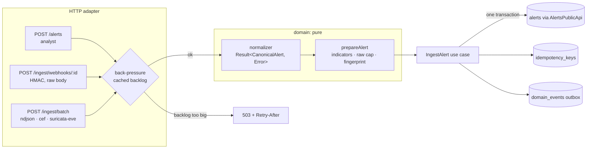

# Module: ingestion

> **Status:** implemented in Phase 1 (`apps/api/src/modules/ingestion`). Decisions:
> [ADR-0030](../adr/0030-pure-normalizers-and-preparation-pipeline.md) ·
> [0031](../adr/0031-source-mapping-rules-suricata-and-cef.md) ·
> [0032](../adr/0032-indicator-normalization.md) ·
> [0033](../adr/0033-ingest-transaction-race-and-idempotency.md) ·
> [0034](../adr/0034-ingest-backpressure-implementation.md) ·
> [0035](../adr/0035-webhook-authentication-details.md), building on
> [ADR-0011](../adr/0011-canonical-alert-schema.md) and [ADR-0012](../adr/0012-idempotency-and-deduplication.md).

## Purpose

Detection tools speak many dialects: Suricata writes EVE JSON, firewalls and EDRs send CEF
over syslog, in-house tools POST JSON. Ingestion is Spine's **front door**: it turns every
dialect into one canonical alert, cleans up its observables, recognizes repeats of an alert
that is already open, makes client retries safe, and refuses work politely when the pipeline
behind it is overloaded. Everything downstream (enrichment, scoring, playbooks) then deals
with exactly one shape, delivered exactly once per distinct alert.

## Design



**Layers** ([ADR-0002](../adr/0002-hexagonal-modular-monolith.md)):

| Layer          | Files                                                                                      | What it does                                                                         |
| -------------- | ------------------------------------------------------------------------------------------ | ------------------------------------------------------------------------------------ |
| `domain/`      | `normalizers/{canonical,suricata-eve,cef,cef-parser,fields}.ts`                            | One pure function per format; never throws on bad input                              |
|                | `indicators.ts`, `ip.ts`                                                                   | Refang, canonicalize, validate, de-duplicate, sort, cap (256)                        |
|                | `fingerprint.ts`, `prepare-alert.ts`                                                       | ADR-0012 fingerprint; 64 KiB raw cap (UTF-8 bytes)                                   |
|                | `webhook-signature.ts`, `idempotency.ts`                                                   | HMAC verification (constant time); key validation, scopes, request hash, 24 h expiry |
| `application/` | `ingest-alert.ts`                                                                          | The transaction: idempotency → dedup or create → events; retries after a lost race   |
|                | `ingest-batch.ts`, `backpressure.ts`, `idempotency-cleanup.ts`, `ports.ts`                 | Per-line batch import, load shedding, the cleanup `BackgroundTask`, secondary ports  |
| `adapters/`    | `http/routes.ts`, `postgres/idempotency-store.ts`, `postgres/transaction.ts`, `metrics.ts` | Fastify routes, Kysely store, OpenTelemetry counters                                 |

The alerts table belongs to the **Alerts** module, so the use case persists through
`AlertsPublicApi` (`findOpenByFingerprint`, `recordDuplicate`, `create`), passing its own
transaction. Events: `alert.ingested` (new alert, full `Alert` snapshot) and
`alert.deduplicated` (`{alertId, fingerprint, duplicateCount, lastSeenAt}`).

**Metrics** (`adapters/metrics.ts`): `spine_alerts_ingested{source,outcome}` where `source` is
the channel (`api`, `batch:<format>`, `webhook:<sourceId>`) and `outcome` is
`created | deduplicated | rejected`; `spine_ingest_backpressure_rejections`.

## Public API

`IngestionPublicApi` is empty: ingestion is an edge module and nothing depends on it.

HTTP endpoints (base `/api/v1`, see [api-contract.md](../architecture/api-contract.md)):

| Endpoint                          | Auth    | Notes                                                                                                                                                             |
| --------------------------------- | ------- | ----------------------------------------------------------------------------------------------------------------------------------------------------------------- |
| `POST /alerts`                    | analyst | Body: `CanonicalAlertInput`. Optional `Idempotency-Key`. `202 IngestResult`; replays carry `Idempotent-Replay: true`                                              |
| `POST /ingest/webhooks/:sourceId` | HMAC    | `X-Spine-Timestamp` (unix s, ±5 min), `X-Spine-Signature: sha256=<hex of HMAC(secret, "ts.body")>`. 404 unknown source, 401 bad signature, 400 unparsable payload |
| `POST /ingest/batch?format=…`     | analyst | `text/plain` or `application/x-ndjson`, ≤ 10 MiB. `200 {accepted, deduplicated, rejected, skipped, errors[≤100]}`                                                 |

Readiness check: `ingest-backlog`. Background task: `ingestion.idempotency-cleanup` (every 15 min).
Rate limit: ingestion routes use their own bucket of 6000 requests/min ([ADR-0024](../adr/0024-api-conventions.md)), keyed by webhook source id, or by client IP for the analyst endpoints (the user is not known yet when the limiter runs).
Webhook sources are configured in `WEBHOOK_SOURCES_JSON` (`{"<id>": {"normalizer": "suricata-eve" | "cef" | "canonical", "secret": "<≥32 chars>"}}`).

Signing a webhook from a shell, for testing:

```bash
ts=$(date +%s); body=$(head -1 apps/api/src/modules/ingestion/fixtures/suricata-eve.ndjson)
sig=$(printf '%s.%s' "$ts" "$body" | openssl dgst -sha256 -hmac "$SECRET" -hex | cut -d' ' -f2)
curl -X POST localhost:3000/api/v1/ingest/webhooks/suricata -H 'content-type: application/json' \
  -H "x-spine-timestamp: $ts" -H "x-spine-signature: sha256=$sig" --data-binary "$body"
```

## Invariants

| Invariant                                                                               | Proved by                                                                                                            |
| --------------------------------------------------------------------------------------- | -------------------------------------------------------------------------------------------------------------------- |
| At most one **open** alert per fingerprint, even under concurrent ingestion             | `ingestion.test.ts` › _collapses 20 concurrent ingests … into 1 open alert with 19 duplicates_ (barrier-forced race) |
| A duplicate never emits `alert.ingested`; a new alert emits it exactly once             | same test (event counts), `ingest-alert.test.ts` › _retries after losing the insert race…_                           |
| A closed alert's recurrence creates a **new** alert                                     | `ingestion.test.ts` › _deduplicates a repeat of an open alert and re-creates after closure_                          |
| Same Idempotency-Key + same body → same response, no side effects; other body → 409     | `ingestion.test.ts` › _replays the stored response…_, _returns 409…_, _serializes concurrent requests…_              |
| Indicator normalization is idempotent, duplicate-free, order-independent, never throws  | `indicators.test.ts` › _normalizeIndicators — properties_                                                            |
| Indicator order never changes the fingerprint; different `sourceAlertId`s never collide | `fingerprint.test.ts` › _property: …_                                                                                |
| Normalizers never throw on malformed input                                              | `suricata-eve.test.ts`, `cef.test.ts` › _rejects … with a typed error_                                               |
| Stored `raw` is ≤ 64 KiB of UTF-8 JSON                                                  | `prepare-alert.test.ts` › _counts UTF-8 bytes…_, `ingestion.test.ts` › _caps an oversized raw payload_               |
| A webhook is accepted only with a valid, fresh signature over the exact raw body        | `webhook-signature.test.ts`, `ingestion.test.ts` › _rejects bad, stale and missing signatures with 401_              |

## Failure modes

| Failure                                             | Behaviour                                                                              | How it's tested                                                       |
| --------------------------------------------------- | -------------------------------------------------------------------------------------- | --------------------------------------------------------------------- |
| Malformed record (bad JSON, missing time, …)        | `400` with a reason (single) or a per-line error (batch, others still ingested)        | normalizer unit tests, _reports per-line errors…_                     |
| Non-alert EVE event (`flow`, `dns`)                 | Batch: counted as `skipped`. Webhook: `400`                                            | _imports a Suricata EVE file…_, _returns 400 for…_                    |
| Two copies of a new alert at the same instant       | Loser's INSERT hits the unique index → transaction re-run → recorded as duplicate      | _collapses 20 concurrent ingests…_                                    |
| Client retries with the same Idempotency-Key        | Stored response replayed (`Idempotent-Replay: true`); concurrent retries serialize     | _serializes concurrent requests with one key…_                        |
| Outbox backlog > `INGEST_MAX_BACKLOG`               | `503` + `Retry-After: 5` before body parsing; `/readyz` reports `ingest-backlog: fail` | _answers 503 + Retry-After and fails readiness…_                      |
| Database down mid-batch                             | Request fails (500); lines already committed stay committed; resending dedups them     | `ingest-alert.test.ts` › _fails the request on infrastructure errors_ |
| Wrong/missing webhook signature, clock skew > 5 min | `401` (reason logged, not returned)                                                    | `webhook-signature.test.ts`                                           |
| Body > 10 MiB (batch) / > 1 MiB (others)            | `413`                                                                                  | _rejects bodies over 10 MiB with 413_                                 |

## How to extend it

**Add a new source format** (e.g. Zeek notice logs):

1. Write `domain/normalizers/zeek-notice.ts` exporting a `Normalizer`. Build a plain object,
   return `validateCanonical(candidate)`; return `err(normalizationError(…))` for bad input.
   Reuse `toIsoTimestamp`, `classifyCategory`, `zipMitre`, `canonicalIp` from `fields.ts`/`ip.ts`.
2. Add synthetic fixtures under `fixtures/` (documentation IP ranges only: 192.0.2.0/24,
   198.51.100.0/24, 203.0.113.0/24, 2001:db8::/32, private ranges, `example.*` domains).
3. Register it in `normalizers/index.ts` (`NORMALIZER_NAMES` + `NORMALIZERS`), add the name to
   `WebhookSourceSchema` in `platform/config.ts`, and to `BATCH_FORMATS` in shared-schema if
   batch import should accept it.
4. Write the unit tests first: one realistic event per fixture line, plus the typed errors.
5. Decide its `sourceAlertId` deliberately: it drives deduplication (see ADR-0031 for the trade-offs).

## How to learn this module

1. Read [ADR-0012](../adr/0012-idempotency-and-deduplication.md), then
   [ADR-0033](../adr/0033-ingest-transaction-race-and-idempotency.md), then `application/ingest-alert.ts` top to bottom.
2. Run `pnpm --filter @spine/api test -- src/modules/ingestion` and read the property tests in
   `domain/indicators.test.ts`. Change `refang` to a single pass and run them again: watch
   fast-check shrink the failure to `http://a.aa/[(.)]`.
3. Run `pnpm --filter @spine/api test:integration -- ingestion` and read the 20-way race test.
   Then read the [journal](../journal/2026-10-28-ingestion-alerts.md) for why it needs a barrier.

### Exercises

1. **Defang in the title.** A sensor sends `title: "Callback to evil[.]example"`. Does it change
   the fingerprint compared to `evil.example`? Should it? Write a test that pins the behaviour you choose.
2. **Beacon floods.** Using the fallback fingerprint, show with a unit test that two Suricata
   beacons from the same host to the same C2 IP would deduplicate if `sourceAlertId` were absent.
   What else would merge, and why did ADR-0031 still keep `flow_id:signature_id`?
3. **A new normalizer.** Add a `zeek-notice` normalizer for one line of Zeek `notice.log` JSON
   (`ts`, `note`, `msg`, `id.orig_h`, `id.resp_h`, `id.resp_p`). Map `note` to the title and
   classify `Scan::Port_Scan` as reconnaissance.
4. **Break the race.** In `IngestAlert`, set the default `maxAttempts` to 1 and run the
   integration tests. Which test fails, with what status code, and why does the idempotency
   test fail too?
5. **Clock skew.** A sender's clock is 6 minutes fast. What does it receive, what is logged,
   and what would you change to support it safely?

Solutions: [exercises/ingestion-solutions.md](exercises/ingestion-solutions.md) (try first!)
