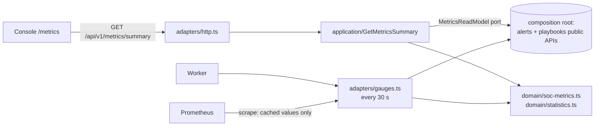

# Module: metrics

## Purpose

A SOC lead needs to know whether the team is getting faster or slower: how long attacks go
unnoticed (**MTTD**), how long it takes to close an alert (**MTTR**), and whether automation
works (**playbook success rate**). The Metrics module computes these with the precise
definitions of [ADR-0026](../adr/0026-mttd-mttr-definitions.md), for the console and for Grafana.

## Design

A **read-side** module ([ADR-0029](../adr/0029-metrics-read-side-module-and-cached-gauges.md)):
it owns no tables, and it reads other modules only through a port.

**Where the numbers are computed** ([ADR-0095](../adr/0095-aggregate-metrics-in-the-database.md)).
Each formula is split in two:

- **aggregate** (count, mean, nearest-rank p50/p90, clock-skew/open/in-flight counts, sparse counts
  per severity and day). In production the **owners compute this in Postgres**
  (`alerts.statsReceivedBetween`, `playbooks.runStatsBetween`), so memory stays constant however
  many alerts the window holds. In TypeScript, `aggregateAlerts`/`aggregateRuns` compute the same
  thing from rows. They are the **executable specification**, and a differential property test
  (`test/integration/metrics-sql.test.ts`) proves that the SQL equals them on random data.
- **present** (zero-filling severities and days, success rate): `alertVolumeFrom`,
  `playbookStatsFrom`, `summaryFromAggregates`, the same code for both paths.

Why: the first soak test showed memory growing with alert volume (~100 MB of heap per refresh at
177 k alerts/day) when rows were loaded into Node.

| File                                 | Role                                                                                                                                             |
| ------------------------------------ | ------------------------------------------------------------------------------------------------------------------------------------------------ |
| `domain/statistics.ts`               | `percentileNearestRank`, `durationStat` (count, mean, p50, p90)                                                                                  |
| `domain/soc-metrics.ts`              | Spec: `computeMttd`, `computeMttr`, `aggregateAlerts`, `aggregateRuns`; present: `alertVolumeFrom`, `playbookStatsFrom`, `summaryFromAggregates` |
| `application/get-metrics-summary.ts` | `MetricsReadModel` port, window resolution/validation, the use case                                                                              |
| `adapters/http.ts`                   | `GET /metrics/summary` (viewer)                                                                                                                  |
| `adapters/gauges.ts`                 | Rolling-24 h Prometheus gauges, refreshed off the scrape path                                                                                    |

## Public API

None. Metrics is a leaf module, and nothing depends on it.

HTTP: `GET /api/v1/metrics/summary?from&to` → `MetricsSummary` (shared-schema). Default window:
the last 7 days. Maximum 90 days. `from` must be before `to`.

Prometheus gauges: `spine_mttd_seconds`, `spine_mttr_seconds`, `spine_playbook_success_ratio`,
`spine_alerts_open_received_24h`.

## Invariants

| Invariant                                                                  | Proven by                                                                       |
| -------------------------------------------------------------------------- | ------------------------------------------------------------------------------- |
| MTTD is never negative; negative TTDs (clock skew) are clamped and counted | `soc-metrics.test.ts` "MTTD is never negative…" (property) and the fixture test |
| `mttr.count + mttr.openCount` = number of alerts in the window             | property test in `soc-metrics.test.ts`                                          |
| min ≤ p50 ≤ p90 ≤ max, and min ≤ mean ≤ max                                | property test "statistics laws"                                                 |
| Percentiles are always observed values (nearest-rank)                      | property test                                                                   |
| Dry-run and cancelled runs never affect the success rate                   | "excludes dry runs and cancelled runs"                                          |
| Approval waiting time is excluded from playbook latency                    | "excludes approval waiting time…"                                               |
| Scrapes never run queries                                                  | design: `adapters/gauges.ts` reads cached values only                           |
| The SQL aggregates equal the TypeScript specification                      | `metrics-sql.test.ts` (differential property test, 60 random datasets each)     |
| Memory doesn't grow with alert volume                                      | design (aggregates only); soak test in performance.md                           |

## Failure modes

| Failure                                | Behaviour                                                | Tested                        |
| -------------------------------------- | -------------------------------------------------------- | ----------------------------- |
| Read model throws during gauge refresh | Previous values keep being served; a warning is logged   | `gauges.test.ts`              |
| No data in the window                  | Stats are `null` (not 0), and the success rate is `null` | fixture tests                 |
| Invalid or oversized window            | 400 problem with a field path                            | `get-metrics-summary.test.ts` |

## How to extend it

Adding a metric such as **MTTA** (time to acknowledge):

1. Add `acknowledgedAt` to `AlertTimes`, and write `computeMtta` in `domain/soc-metrics.ts` next to
   `computeMttr` (the specification), with a fixture test whose expected numbers you compute by hand first.
2. Add the matching aggregate to `alerts.statsReceivedBetween` (SQL), and extend the differential
   test in `metrics-sql.test.ts` so it compares your SQL with your TypeScript.
3. Extend `MetricsSummarySchema` in `@spine/shared-schema` **additively** (an optional field).
4. Add a gauge in `adapters/gauges.ts` and a Grafana panel.

## How to learn this module

1. Read ADR-0026, then `domain/statistics.ts`. Why nearest-rank and not linear interpolation?
2. Open `test/unit/metrics/soc-metrics.test.ts` and recompute the fixture's MTTD by hand.
3. Run `pnpm --filter @spine/api test -- metrics` and break `percentileNearestRank` on purpose
   (use `Math.floor`). Watch the property test find a counterexample and shrink it.

### Exercises

1. **Off-by-one hunt.** Change `Math.ceil` to `Math.round` in `percentileNearestRank`. Which tests fail, and what is the smallest counterexample fast-check reports? Explain it.
2. **Median vs mean.** Construct a 10-alert fixture where MTTR's mean is more than 5× its median. What does that tell a SOC lead that the mean alone hides?
3. **Add p99.** Add `p99Seconds` to `DurationStat` additively, with tests. Why is p99 of 10 samples misleading?
4. **Business hours.** Some SOCs measure MTTR only during staffed hours. Sketch the design change (where does the calendar live, domain or adapter?), and write the ADR's "options considered" section.
5. **Break the SQL, not the spec.** In `alerts/adapters/postgres/reporting-queries.ts`, change `percentile_disc` to `percentile_cont`. Run `metrics-sql.test.ts`. What counterexample does fast-check shrink to, and why can no unit test of `soc-metrics.ts` ever catch this bug?

Solutions: [exercises/metrics-solutions.md](exercises/metrics-solutions.md) (try first!).
