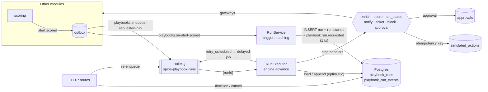

# Module: playbooks

## Purpose

When an alert is scored, a SOC wants the routine response done for it: enrich, decide,
ask a human before anything risky, block, open a ticket, tell the team, and undo the
block if the rest fails. The playbooks module stores those procedures as versioned,
validated **playbooks** ([ADR-0013](../adr/0013-playbook-dsl.md)), starts **runs** of them
automatically (on `alert.scored`) or by hand, executes them **durably** so a crashed
worker never loses or repeats an action ([ADR-0010](../adr/0010-event-sourcing-for-playbook-runs-only.md),
[ADR-0050](../adr/0050-playbook-engine-reduce-decide-act.md)), gates risky steps behind
**approvals**, and performs every response action through **simulated adapters**
([ADR-0018](../adr/0018-simulated-response-adapters.md)).

## Design

The pure engine lives in [`packages/playbook-engine`](../../packages/playbook-engine/README.md):
DSL parsing/validation, the run reducer, the decider and the executor loop. This module
hosts it: persistence, queueing, step handlers, HTTP and events.

Layers ([ADR-0002](../adr/0002-hexagonal-modular-monolith.md)):

| Layer          | Files                                                                                                                  | What lives there                                                                                                             |
| -------------- | ---------------------------------------------------------------------------------------------------------------------- | ---------------------------------------------------------------------------------------------------------------------------- |
| `domain/`      | `trigger.ts`, `indicators.ts`, `approval.ts`, `run-view.ts`                                                            | Pure rules: trigger matching, which indicators may be blocked, approval decision rules, projection and domain-event mapping. |
| `application/` | `ports.ts`, `catalog.ts`, `runs.ts`, `approvals.ts`, `executor.ts`, `step-handlers.ts`                                 | Use cases and port interfaces (gateways to other modules, response-action ports, repositories, unit of work, queue).         |
| `adapters/`    | `postgres/*`, `queue/run-queue.ts`, `simulated/*`, `http/routes.ts`, `events/subscribers.ts`, `tasks.ts`, `metrics.ts` | Kysely repositories, BullMQ, simulated integrations, Fastify routes, outbox subscribers, background tasks, OpenTelemetry.    |

Key mechanics:

- **Append = one transaction** ([ADR-0055](../adr/0055-run-projection-and-outbox-in-append-transaction.md)):
  bump `last_seq` from the expected value (else `ConcurrencyError`), insert events,
  re-reduce, rewrite the `playbook_runs` projection, publish `approval.requested`,
  `approval.decided`, `playbook.run.finished` to the outbox.
- **One job = one `advance`** ([ADR-0051](../adr/0051-executor-hosting-on-bullmq.md)):
  the outcome schedules the next job (delayed for retries). Job IDs `run__<id>__<seq>`.
  A startup reconciler re-enqueues `pending`/`running`/`compensating` runs; a sweeper
  applies approval `onTimeout`.
- **Snapshot inputs** ([ADR-0053](../adr/0053-run-snapshot-and-evaluation-context.md)): the
  `run.started` event stores `{alert, score, enrichments}`; conditions see
  `enrichment.verdicts.<type>`, `enrichment.malicious`, `score.score`…
- **Dry-run, cancel, timeouts** ([ADR-0052](../adr/0052-run-lifecycle-dry-run-cancel-timeout.md)).
- **Seeding:** the worker inserts `apps/api/config/playbooks/*.yaml` whose `(id, version)`
  is not stored yet: `malware-containment`, `phishing-triage`, `brute-force-response`.

## Public API

`public-api.ts`: `PlaybooksPublicApi.runsForAlert(alertId)` → run summaries, newest first
(used by the alert detail view), and `runStatsBetween(from, to)` → outcome counts, latency and
approval-wait statistics of the runs that finished in the window, plus the in-flight count, computed
in Postgres (the Metrics read model, ADR-0026/0029/0095).

HTTP (all under `/api/v1`, see [api-contract.md](../architecture/api-contract.md)):

| Method | Path                      | Role    | Notes                                                                                     |
| ------ | ------------------------- | ------- | ----------------------------------------------------------------------------------------- |
| GET    | `/playbooks`              | viewer  | Latest version of each playbook                                                           |
| GET    | `/playbooks/:id?version`  | viewer  | Definition + source                                                                       |
| POST   | `/playbooks/validate`     | analyst | `200 {valid, definition}` or `422` with **all** errors                                    |
| POST   | `/playbooks`              | admin   | New immutable version; `409` unless `metadata.version` > latest                           |
| PATCH  | `/playbooks/:id`          | admin   | `{enabled}` on the latest version (only affects automatic triggering)                     |
| POST   | `/playbooks/:id/runs`     | analyst | `{alertId, dryRun}` → `202 {runId}`                                                       |
| GET    | `/runs`, `/runs/:id`      | viewer  | Keyset pages; detail = events + derived step states                                       |
| POST   | `/runs/:id/cancel`        | analyst | `202 RunSummary`; `409` if terminal                                                       |
| GET    | `/approvals?status`       | viewer  | Keyset pages                                                                              |
| POST   | `/approvals/:id/decision` | analyst | `200 Approval`; `409` decided/expired; `403` if `approverRole` is above the caller's role |
| GET    | `/simulated-actions?kind` | viewer  | What the simulated firewall/ticketing/chat "did"                                          |

Events: consumes `alert.scored`, `playbook.run.requested`, `approval.decided`; publishes
`playbook.run.requested`, `playbook.run.finished`, `approval.requested`, `approval.decided`.

Ports onto other modules, wired in `composition.ts`: `AuditGateway` → the auth module's
`audit.record` (approval decisions are audited **inside** the decision transaction);
`EnrichmentGateway`, `ScoringGateway`, `AlertStatusGateway` and `AlertSnapshotGateway` are
placeholders marked `// INTEGRATION` until Phase 2.

Metrics: `spine_playbook_runs{playbook,status}`, `spine_playbook_run_duration_seconds{playbook,status}`,
`spine_playbook_step_duration_seconds{type,status}`, `spine_approvals_pending`.

## Invariants

| Invariant                                                                             | Proven by                                                                                                       |
| ------------------------------------------------------------------------------------- | --------------------------------------------------------------------------------------------------------------- |
| Every accepted playbook is acyclic, connected and has no dangling references          | `packages/playbook-engine/test/properties.test.ts` › property: validation (3 properties)                        |
| A run with succeeding handlers executes each step on its path exactly once            | properties › "with succeeding handlers, terminates succeeded and runs each step on the taken path exactly once" |
| A crash anywhere never re-runs a completed step nor changes a step's idempotency key  | properties › both "crash-resume" properties; `playbooks.test.ts` › "crash/resume: …"                            |
| Compensation runs in exact reverse order of completion                                | properties › "with a failing step, compensation runs in exact reverse order of completion"                      |
| One idempotency key → at most one simulated action row                                | `playbooks.test.ts` › "crash/resume…", "optimistic concurrency: two concurrent advances…"                       |
| Concurrent appends never interleave: seqs are gap-free and each step succeeds once    | `playbooks.test.ts` › "optimistic concurrency: …"                                                               |
| The projection always equals a rebuild from the events                                | `playbooks.test.ts` › "keeps the playbook_runs projection equal to a rebuild from the events"                   |
| At most one automatic run per (playbook, alert): `alert.scored` redelivery is a no-op | `playbooks.test.ts` › "is idempotent: redelivering alert.scored creates no second run"                          |
| A dry run creates no non-dry simulated action and no approval                         | `playbooks.test.ts` › "dry-run: skips the approval and records only dry-run simulated actions"                  |
| An approval decision is never stored without its audit entry (one transaction)        | `playbooks.test.ts` › "a decision and its audit entry commit together…"                                         |
| An approval is decided at most once                                                   | `playbooks-http.test.ts` › "records a decision once; a second decision is a 409"                                |
| After Redis loses its jobs, every resumable run (and only those) is re-enqueued       | `playbooks-queue.test.ts` › "reconciler: …"                                                                     |

## Failure modes

| Failure                                                  | Behaviour                                                                                                | How it's tested                                                            |
| -------------------------------------------------------- | -------------------------------------------------------------------------------------------------------- | -------------------------------------------------------------------------- |
| Worker dies mid-step                                     | BullMQ re-delivers the stalled job (or the reconciler re-enqueues); the step is re-run with the same key | crash/resume tests (engine properties + integration)                       |
| Two workers advance the same run                         | The second append fails with `ConcurrencyError`; the loser reloads and continues                         | "optimistic concurrency" integration test                                  |
| Simulated integration outage (`SIMULATION_FAILURE_RATE`) | `step.failed` → `step.retry_scheduled` (backoff) → delayed job → new attempt key                         | "retries a failing step with backoff…"                                     |
| Step fails after retries (`onFailure: fail`)             | Completed steps with `compensate` are undone in reverse order → `run.compensated` (or `run.failed`)      | "compensates a completed block…", engine tests                             |
| Step exceeds `timeoutMs`                                 | The handler's `AbortSignal` fires and the attempt fails with "timed out"                                 | engine › "fails a step that exceeds its timeout"                           |
| Nobody answers an approval                               | Sweeper marks it `expired` and applies `onTimeout`                                                       | "expiry: the sweeper applies onTimeout…"                                   |
| Redis wiped                                              | Startup reconciler rebuilds the queue from Postgres                                                      | `playbooks-queue.test.ts` › reconciler                                     |
| Invalid playbook file in `config/playbooks`              | Logged and skipped; other files are seeded                                                               | `playbooks.test.ts` › "skips invalid playbook files…"                      |
| Event log corrupted (seq gap, unknown step)              | `RunStateError`: the job fails loudly and is kept in BullMQ's failed set                                 | engine › reduce guards                                                     |
| Worker shutdown                                          | In-flight handlers are aborted; the step stays "started" and resumes later                               | engine › "yields without recording anything when the host aborts mid-step" |

## How to extend it

**Add a step type** (e.g. `isolate_host`):

1. Add its schema to `StepSchema` in `packages/shared-schema/src/playbook.ts` (with a
   `compensate` if it is reversible) and to `STEP_TYPES`.
2. Add a port for the integration in `application/ports.ts` (e.g. `EdrPort`) and a
   simulated adapter in `adapters/simulated/integrations.ts` that goes through
   `SimulatedActionRecorder.perform` (so it is idempotent and fault-injectable). Add the
   new kind to `SIMULATED_ACTION_KINDS`.
3. Add the handler in `application/step-handlers.ts`; use `ctx.idempotencyKey`,
   honour `ctx.dryRun` and pass `ctx.signal` to I/O.
4. Write a unit test next to the existing handler tests and one integration test.
5. Use it in a playbook under `apps/api/config/playbooks` with a new `metadata.version`.

## How to learn this module

1. Read the engine README, then `packages/playbook-engine/src/reduce.ts` and `decide.ts`
   (pure, ~300 lines). Then `executor.ts`: find where `step.started` is appended before
   the handler runs, and why.
2. Run `pnpm --filter @spine/playbook-engine test` and open `test/properties.test.ts`. Break
   something on purpose (e.g. make `decide` return `attempt + 1` when resuming) and watch the
   crash-resume property print a shrunk counter-example.
3. Read `adapters/postgres/run-repository.ts` `append()` and match each step to ADR-0055.
4. Run `pnpm --filter @spine/api test:integration -- playbooks` and read
   `playbooks.test.ts` › "optimistic concurrency": it forces two workers into the same step.
5. Trace sequence §2 in [sequences.md](../architecture/sequences.md) through the code.

### Exercises

1. **Find the line.** A worker crashes after the simulated firewall inserted its row but
   before `step.succeeded` is appended. Which lines guarantee the firewall is not called
   twice with different keys, and which guarantee the step still completes?
2. **A new property.** Write a fast-check property: "in any final log, no step has two
   `step.succeeded` events, and every `step.succeeded` follows a `step.started` of the same
   step". Reuse `drive` and `reference` from `properties.test.ts`.
3. **Deterministic jitter.** Retry delays have no jitter (ADR-0050). Add jitter without
   making logs non-reproducible.
4. **Hyphens in paths.** `{{steps.block-source.output}}` doesn't render (ADR-0053). What
   would you change, and what else would that change affect?
5. **Cancel and roll back.** Sketch "cancel with compensation" (ADR-0052 revisit): which
   event, which reducer and decider changes, which tests?

Solutions: [exercises/playbooks-solutions.md](exercises/playbooks-solutions.md) (try first!)
