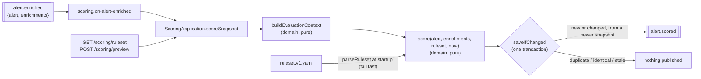

# Module: scoring

> **Status:** implemented (Phase 1). Code: [`apps/api/src/modules/scoring`](../../apps/api/src/modules/scoring),
> ruleset: [`apps/api/config/scoring/ruleset.v1.yaml`](../../apps/api/config/scoring/ruleset.v1.yaml).

## Purpose

A SOC queue has hundreds of alerts and an analyst has time for a few dozen. Scoring
answers "which one first?" with a number from 0 to 100, and, more importantly, **why**.
Every score comes with an explanation that lists each contributing factor, the evidence
that triggered it, and any enrichment provider whose data was missing. Analysts trust a
score they can check, and detection engineers can tune rules with a YAML diff
([ADR-0015](../adr/0015-explainable-rule-based-scoring.md)).

## Design



**The formula:**

```
rawScore = baseline[alert.severity] + Σ points of every rule whose `when` matches
score    = clamp(0, 100, rawScore)
severity = 0–19 informational · 20–39 low · 40–59 medium · 60–79 high · 80–100 critical
```

**Layers:**

| Layer       | File                                                            | Responsibility                                                                                        |
| ----------- | --------------------------------------------------------------- | ----------------------------------------------------------------------------------------------------- |
| domain      | `domain/evaluation-context.ts`                                  | Summarize enrichment into rule-friendly facts ([ADR-0043](../adr/0043-scoring-evaluation-context.md)) |
|             | `domain/engine.ts`                                              | `score()`: baseline + matching rules + evidence + data gaps                                           |
|             | `domain/ruleset.ts`                                             | `parseRuleset()`: schema + semantic validation                                                        |
| application | `application/scoring-app.ts`, `application/ports.ts`            | Use cases; `ScoreRepository` port                                                                     |
| adapters    | `adapters/postgres.ts`                                          | `saveIfChanged` ([ADR-0042](../adr/0042-scoring-publish-only-on-change.md))                           |
|             | `adapters/ruleset-loader.ts`                                    | Read + parse YAML once ([ADR-0046](../adr/0046-ruleset-loaded-once-fail-fast.md))                     |
|             | `adapters/events.ts`, `adapters/http.ts`, `adapters/metrics.ts` | Subscriber, routes, instruments                                                                       |

The engine is pure: no I/O, and the clock is a parameter. That's why it can be
property-tested exhaustively, and why "same alert + same enrichments + same ruleset → same
score" holds.

### Explanation format

```json
{
  "score": 90,
  "rawScore": 90,
  "severity": "critical",
  "rulesetVersion": 1,
  "factors": [
    {
      "ruleId": "baseline",
      "description": "Baseline for source severity \"high\"",
      "points": 40,
      "evidence": "severity=high"
    },
    {
      "ruleId": "malicious-indicator",
      "description": "At least one indicator has a malicious reputation verdict",
      "points": 30,
      "evidence": "203.0.113.66"
    },
    {
      "ruleId": "critical-asset",
      "description": "The affected host is a critical asset (e.g. domain controller, payment database)",
      "points": 20,
      "evidence": "dc01.corp.example"
    }
  ],
  "dataGaps": [],
  "computedAt": "2026-10-28T10:00:02.000Z"
}
```

- The **baseline** factor always comes first. When no rule matched, its description ends
  with `; no scoring rule matched`, so the explanation is explicit (success metric S5).
- **Evidence** is the value at the rule's `evidenceField`, or, if it has none, at the
  first field its condition mentions. Arrays are joined with `, `, objects are JSON, and
  the text is capped at 500 characters.
- **`dataGaps`** lists providers with at least one failed lookup (`timeout`, `error`,
  `circuit_open`, `rejected`). A rule that needed their data simply didn't match.

### Evaluation context

Rules are conditions in the shared predicate language ([ADR-0013](../adr/0013-playbook-dsl.md)):
`{all: […]}`, `{any: […]}`, `{not: …}` and `{field, op, value}` with
`op ∈ eq | neq | gt | gte | lt | lte | in | contains | exists | matches`. `field` is a dotted
path into this object:

```
{ alert: Alert, enrichment: EnrichmentSummary }
```

**`alert.*`**: the canonical alert snapshot ([ADR-0011](../adr/0011-canonical-alert-schema.md)).

| Path                                                                        | Type             | Example / note                                                                                  |
| --------------------------------------------------------------------------- | ---------------- | ----------------------------------------------------------------------------------------------- |
| `alert.severity`                                                            | severity         | `high` (what the source reported; drives the baseline)                                          |
| `alert.category`                                                            | category         | `malware`, `phishing`, `credential_access`, … (see `ALERT_CATEGORIES`)                          |
| `alert.title`, `alert.description`                                          | string           | use `matches` / `contains`                                                                      |
| `alert.source.vendor`, `.product`                                           | string           | `Suricata`                                                                                      |
| `alert.mitre.tacticId`                                                      | string[]         | **flattened** over all mappings: `["TA0006","TA0011"]`; use `contains`                          |
| `alert.mitre.techniqueId`                                                   | string[]         | `["T1003.001"]`; use `matches: '^T1003(\.\d{3})?$'` for a technique and its sub-techniques      |
| `alert.duplicateCount`                                                      | integer          | how often it repeated (deduplication, [ADR-0012](../adr/0012-idempotency-and-deduplication.md)) |
| `alert.host.hostname`, `alert.host.ips`                                     | string, string[] |                                                                                                 |
| `alert.user.name`, `alert.user.email`                                       | string           |                                                                                                 |
| `alert.network.sourceIp`, `.destinationIp`, `.destinationPort`, `.protocol` | string / number  |                                                                                                 |
| `alert.file.sha256`, `alert.file.name`                                      | string           |                                                                                                 |
| `alert.url`                                                                 | string           |                                                                                                 |
| `alert.indicators.type`, `alert.indicators.value`                           | string[]         | flattened: all indicator types / values                                                         |
| `alert.labels.<key>`                                                        | string           | free-form source labels                                                                         |
| `alert.status`, `alert.receivedAt`, …                                       |                  | every `Alert` field is reachable                                                                |

**`enrichment.*`**: built by `buildEvaluationContext` from the successful (`ok`) results.
Lists are de-duplicated and sorted.

| Path                                 | Type                          | Meaning                                                                        |
| ------------------------------------ | ----------------------------- | ------------------------------------------------------------------------------ |
| `enrichment.verdicts`                | verdict[]                     | distinct verdicts, most severe first: `["malicious","suspicious"]`             |
| `enrichment.maxReputationScore`      | number \| null                | highest reputation score (0–100); null if no reputation data                   |
| `enrichment.maliciousIndicators`     | string[]                      | values judged malicious: `["203.0.113.66","evil.example"]`                     |
| `enrichment.maliciousIndicatorTypes` | indicator type[]              | their types: `["domain","ipv4"]`                                               |
| `enrichment.suspiciousIndicators`    | string[]                      | values judged suspicious                                                       |
| `enrichment.reputationTags`          | string[]                      | union of reputation tags: `["c2","cobalt-strike"]`                             |
| `enrichment.asset`                   | object \| null                | the **most critical** asset found for the host or its IPs                      |
| `enrichment.asset.hostname`          | string                        | `dc01.corp.example`                                                            |
| `enrichment.asset.criticality`       | `low\|medium\|high\|critical` |                                                                                |
| `enrichment.asset.owner`             | string \| null                | `identity-team@corp.example`                                                   |
| `enrichment.asset.businessUnit`      | string \| null                | `IT Infrastructure`                                                            |
| `enrichment.asset.tags`              | string[]                      | `["domain-controller","tier0"]`                                                |
| `enrichment.assetTags`               | string[]                      | union of the tags of **every** asset found (e.g. the scanner _and_ its target) |
| `enrichment.geo.countries`           | string[]                      | ISO country codes of the public IPs: `["DE","NL"]`                             |
| `enrichment.geo.asns`                | number[]                      | autonomous system numbers                                                      |
| `enrichment.geo.isTor`               | boolean                       | any IP is a Tor exit node                                                      |
| `enrichment.geo.torIps`              | string[]                      | which ones                                                                     |
| `enrichment.failedProviders`         | string[]                      | providers with a failed lookup (also in `dataGaps`)                            |

**Semantics to remember** (from the interpreter, `condition-eval.ts`):

- A missing or null value makes every operator false, `neq` included. `enrichment.asset.criticality neq low`
  is **false** when no asset was found. Use `not` explicitly if you mean "absent or not low".
- `contains` on a list checks membership; on a string, it checks for a substring.
- Ordering operators compare numbers only.
- A path is checked at startup: it must start with `alert.<a real Alert field>` or
  `enrichment.<a key above>`. Deeper segments are not checked (`enrichment.asset.critcality`
  would pass and never match), so test new rules with `POST /scoring/preview`.

## Public API

`ScoringPublicApi` ([public-api.ts](../../apps/api/src/modules/scoring/public-api.ts)):

| Member                              | Behaviour                                                                   |
| ----------------------------------- | --------------------------------------------------------------------------- |
| `getForAlert(alertId)`              | Latest stored explanation (by `computed_at`, any ruleset version), or null  |
| `preview(alert, enrichments)`       | Pure: explanation with the active ruleset, nothing stored                   |
| `scoreAndStore(alert, enrichments)` | Stores and publishes `alert.scored` if new or changed (snapshot time = now) |
| `activeRuleset()`                   | The ruleset loaded at startup                                               |

**Events.** Consumes `alert.enriched` (subscriber `scoring.on-alert-enriched`). Publishes
`alert.scored` `{alert, enrichments, score}` **only when the score is new or changed**
([ADR-0042](../adr/0042-scoring-publish-only-on-change.md)).

**HTTP** (under `/api/v1`):

| Method | Path               | Role    | Request → response                                                                                 |
| ------ | ------------------ | ------- | -------------------------------------------------------------------------------------------------- |
| GET    | `/scoring/ruleset` | viewer  | → `200 Ruleset`                                                                                    |
| POST   | `/scoring/preview` | analyst | `{alert: Alert \| CanonicalAlertInput, enrichments?: EnrichmentResult[]}` → `200 ScoreExplanation` |

**Configuration:** `SCORING_RULESET_FILE` (default `scoring/ruleset.v1.yaml`, relative to `CONFIG_DIR`).

**Metrics:** `spine_alerts_scored{severity}` (counter, published scores only) and
`spine_alert_score` (histogram, buckets every 10 points).

**Data:** `alert_scores (alert_id, ruleset_version)` PK, with `source_occurred_at` (migration 0501).

## Invariants

| Invariant                                                                                        | Proven by                                                                                                    |
| ------------------------------------------------------------------------------------------------ | ------------------------------------------------------------------------------------------------------------ |
| `score` is an integer in [0, 100] and `severity = severityFromScore(score)`                      | `test/unit/scoring/engine.test.ts` › _property: score is always an integer in [0, 100]…_                     |
| `rawScore` = Σ factor points; there is always ≥ 1 factor and the first is the baseline           | _property: rawScore is exactly the sum…_                                                                     |
| Deterministic: same inputs → same explanation                                                    | _property: is deterministic_                                                                                 |
| Adding a matching rule with positive points never lowers the score                               | _property: adding a matching rule with positive points…_                                                     |
| With no rules, only the baseline factor remains                                                  | _property: removing all rules leaves only the baseline factor_                                               |
| `dataGaps` = exactly the providers with a failed lookup                                          | _property: dataGaps lists exactly…_                                                                          |
| An invalid ruleset (schema, duplicate id, unsafe regex, unknown path) stops the process          | `ruleset.test.ts` › _collects every semantic problem at once_; `http.test.ts` › _ruleset loading fails fast_ |
| At most one `alert.scored` per distinct (alert, ruleset version, explanation), even concurrently | `test/integration/scoring.test.ts` › _is idempotent per alert + ruleset version_                             |
| An older enrichment snapshot never overwrites a newer score                                      | `scoring.test.ts` › _re-scores when newer enrichment changes the score, ignores stale snapshots_             |

## Failure modes

| Failure                                          | Behaviour                                                                                   | How it's tested                                       |
| ------------------------------------------------ | ------------------------------------------------------------------------------------------- | ----------------------------------------------------- |
| A provider was down during enrichment            | Its rules don't match; it's listed in `dataGaps`; re-enrich later re-scores                 | pipeline test _with every provider down_              |
| Ruleset file missing / bad YAML / invalid rules  | Module creation throws `InvalidRulesetError` listing every problem; the process won't start | `http.test.ts` › _ruleset loading fails fast_         |
| `alert.enriched` redelivered                     | Identical explanation, so nothing stored and nothing published                              | `scoring.test.ts` › _is idempotent…_                  |
| Two `alert.enriched` events handled out of order | The stale one is ignored (`source_occurred_at` guard)                                       | `scoring.test.ts` › _…ignores stale snapshots_        |
| Database down                                    | Handler throws; BullMQ retries the delivery                                                 | platform retry policy                                 |
| Malformed preview request                        | `400 validation-error` problem                                                              | `http.test.ts` › _rejects viewers and invalid bodies_ |

## How to extend it

**Add or change a rule** (tutorial 01 will expand on this):

1. Write the question as a condition over the [evaluation context](#evaluation-context).
   Example, "credential access on a Finance asset":
   ```yaml
   - id: finance-credential-access
     description: Credential access against a Finance-owned asset
     when:
       all:
         - { field: alert.mitre.tacticId, op: contains, value: TA0006 }
         - { field: enrichment.asset.businessUnit, op: eq, value: Finance }
     points: 10
     evidenceField: enrichment.asset.hostname
   ```
2. Try it with `POST /scoring/preview` on a few real alerts before committing.
3. A change in meaning (new rule, changed points) goes into a **new** file with a new `version`
   (`ruleset.v2.yaml`) and `SCORING_RULESET_FILE` is pointed at it. Typo fixes in
   descriptions can stay in place.
4. Add a case to `test/unit/scoring/ruleset.test.ts › shipped ruleset … on realistic alerts`.

**Add a new fact** (e.g. "the user is a VIP"): add a field to `EnrichmentSummary` and
`ENRICHMENT_SUMMARY_KEYS` in `domain/evaluation-context.ts`, derive it in
`buildEvaluationContext`, document it in the table above, and test it.

## How to learn this module

1. Read [ADR-0015](../adr/0015-explainable-rule-based-scoring.md), then `domain/engine.ts`.
   It's about 90 lines.
2. Read `config/scoring/ruleset.v1.yaml` top to bottom. Every rule has a comment explaining why.
3. Run `pnpm --filter @spine/api test -- scoring` and read the property tests in
   `engine.test.ts`. Each one is a sentence from ADR-0015, made executable.
4. Read `adapters/postgres.ts › saveIfChanged` with [ADR-0042](../adr/0042-scoring-publish-only-on-change.md).
   Then try to break it: what if step 4 didn't advance `source_occurred_at`?

### Exercises

1. **Hand-score.** A `medium` phishing alert, repeated 12 times, with a malicious URL and a
   Tor exit IP, and the asset inventory timed out. Compute the score, severity, factors and
   data gaps under ruleset v1 by hand, then check with `POST /scoring/preview`.
2. **The `neq` trap.** Write a rule "the asset is not low-criticality" that also matches
   when no asset was found. Then write one that matches only when an asset _was_ found and
   it isn't low. Why are they different?
3. **A combination rule.** Additive scoring can't express "Tor **and** credential access
   is worse than the sum". Add a rule for it and a unit test proving it only fires when both hold.
4. **A property of your own.** Write a fast-check property: "a rule with **negative**
   points never raises the score". Does it hold? What about rules matching a `not` condition?
5. **Ruleset v2.** You want `critical-asset` to give 25 points instead of 20. Walk
   through every step (files, version, tests, deployment), and explain what happens to
   alerts already scored under v1.

Solutions: [exercises/scoring-solutions.md](exercises/scoring-solutions.md) (try first!)
