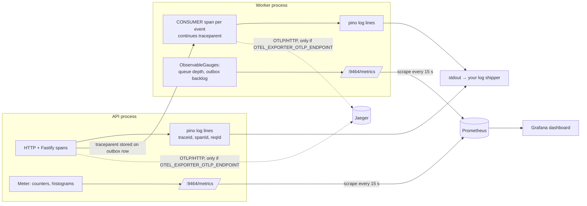
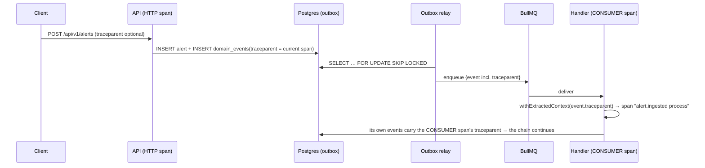

# Observability

How Spine tells you what it is doing: **metrics** (Prometheus), **traces** (OpenTelemetry,
optional Jaeger) and **logs** (pino JSON on stdout), joined by a shared `traceId` and
`requestId`. Decisions: [ADR-0019](../adr/0019-observability-otel-pino-prometheus.md),
[ADR-0080](../adr/0080-telemetry-bootstrap-and-metric-conventions.md). Code:
`apps/api/src/platform/telemetry/`, `apps/api/src/instrument.ts`.

## The three signals at a glance



| Signal  | Where it goes                                        | Always on?                                          |
| ------- | ---------------------------------------------------- | --------------------------------------------------- |
| Metrics | `http://<process>:METRICS_PORT/metrics` (pull)       | Yes (`METRICS_PORT=0` disables the endpoint)        |
| Traces  | OTLP/HTTP to `OTEL_EXPORTER_OTLP_ENDPOINT/v1/traces` | Spans always exist in-process; exported only if set |
| Logs    | stdout, one JSON object per line                     | Yes                                                 |

## How the SDK starts (and why it is a preload)

`node --import ./dist/instrument.js dist/main.js` (same for `dist/worker.js`). The
preload starts the OpenTelemetry `NodeSDK` **before** the application's imports run, so
the `http`, `pg` and `ioredis` instrumentations can patch those libraries as they load.
`startTelemetry()` in `main.ts`/`worker.ts` then returns the already-running instance
(it is a process-wide singleton on `globalThis`, because the preload and the entrypoint
are separate bundles). Without the preload (e.g. `pnpm dev`), metrics and manual spans
still work; only library auto-instrumentation is missing.

Tests never start the SDK: `getMeter()`/`getTracer()` return no-op implementations until
it runs. **Create instruments inside factories called from `createApplication`, not at
module top level**: the OTel metrics API has no proxy meter, so an instrument created
before the SDK starts stays a no-op forever.

## Metric naming as verified

We started a process with the SDK and read `/metrics` (exporter
`@opentelemetry/exporter-prometheus` 0.222.0). Probe instruments and what the exporter wrote:

| Instrument created as                              | Exported as (`# TYPE`)                                  |
| -------------------------------------------------- | ------------------------------------------------------- |
| counter `spine_probe_events`                       | `spine_probe_events_total` counter                      |
| counter `spine_probe_events_total`                 | `spine_probe_events_total` (not doubled, but collides!) |
| histogram `spine_probe_duration_seconds` (no unit) | `spine_probe_duration_seconds` + `_bucket/_sum/_count`  |
| histogram `spine_probe_latency` with `unit: 's'`   | `spine_probe_latency` (`# UNIT … s`, **no** `_seconds`) |
| up-down counter / gauge / observable gauge         | plain name, `gauge`                                     |
| observable counter `spine_process_cpu_seconds`     | `spine_process_cpu_seconds_total` counter               |

So, the rules every module follows (they match the shared brief):

1. **Counters:** name without `_total`; the exporter appends it. Query `…_total`.
2. **Histograms:** put the unit in the name (`_seconds`, `_bytes`) and pass **no** `unit`
   option. The exporter never appends unit suffixes.
3. **Gauges:** plain names.
4. Every series carries `otel_scope_name` (and `otel_scope_version` for library
   instruments); always aggregate with `sum by (…)`/`max by (…)` in queries.
5. Resource attributes are **not** labels on each series; they are in `target_info`
   (`service_name`, `service_version`, `deployment_environment_name`, `host_name`).
   Prometheus adds `job` and `instance`, and our scrape config adds `service`.

A second finding: the SDK's **default histogram buckets are `0, 5, 10, 25, 50, 75, 100,
250, 500, 750, 1000, 2500, 5000, 7500, 10000`**, which are designed for milliseconds. A
`_seconds` histogram with those buckets puts every observation under 5 s in one bucket.
`startTelemetry` therefore installs a View that gives every `spine_*_seconds` histogram
the buckets `0.005 … 3600` s (`SECONDS_BUCKETS` in `sdk.ts`). Library histograms (HTTP,
pg) bring their own second-scale buckets via OTel "advice".

Real output from the compose stack (worker, excerpt):

```text
# HELP target_info Target metadata
# TYPE target_info gauge
target_info{host_name="27aba2eb1031",host_arch="amd64",service_name="spine-worker",service_version="0.0.0-dev",deployment_environment_name="development"} 1
# HELP spine_process_cpu_seconds_total CPU time consumed by the process, by mode
# TYPE spine_process_cpu_seconds_total counter
spine_process_cpu_seconds_total{mode="user",otel_scope_name="spine"} 1.131738
# HELP spine_queue_depth BullMQ jobs per queue and state (waiting, active, delayed, failed)
# TYPE spine_queue_depth gauge
spine_queue_depth{queue="spine-events",state="waiting",otel_scope_name="spine"} 0
```

and from the API:

```text
# UNIT http_server_request_duration s
# TYPE http_server_request_duration histogram
http_server_request_duration_count{http_request_method="GET",url_scheme="http",network_protocol_version="1.1",http_route="/api/v1/openapi.json",http_response_status_code="200",otel_scope_name="@opentelemetry/instrumentation-http",otel_scope_version="0.222.0"} 1
```

Note the HTTP histogram is `http_server_request_duration` (stable OTel semantic
conventions), **not** `http_server_duration` (old conventions) nor
`http_server_request_duration_seconds`.

## Metric catalogue

As exported (query names). "Owner" is the module that records it; rows marked Phase 2 are
agreed names that the dashboard already queries and that show "No data" until the module
publishes them.

| Metric                                                                 | Type             | Labels                                                           | Owner                       |
| ---------------------------------------------------------------------- | ---------------- | ---------------------------------------------------------------- | --------------------------- |
| `spine_alerts_ingested_total`                                          | counter          | `source`, `outcome` (created/deduplicated/rejected)              | ingestion                   |
| `spine_ingest_backpressure_rejections_total`                           | counter          | —                                                                | ingestion                   |
| `spine_enrichment_duration_seconds`                                    | histogram        | `provider`, `status`                                             | enrichment                  |
| `spine_enrichment_circuit_state`                                       | gauge            | `provider` (0 closed, 1 half-open, 2 open)                       | enrichment                  |
| `spine_alerts_scored_total`                                            | counter          | `severity`                                                       | scoring                     |
| `spine_alert_score`                                                    | histogram        | —                                                                | scoring                     |
| `spine_alert_time_to_score_seconds`                                    | histogram        | — (receivedAt → score stored; SLO 2)                             | scoring (proposed, Phase 2) |
| `spine_playbook_runs_total`                                            | counter          | `playbook`, `status`                                             | playbooks                   |
| `spine_playbook_run_duration_seconds`                                  | histogram        | `playbook`, `status`                                             | playbooks                   |
| `spine_playbook_step_duration_seconds`                                 | histogram        | `type`, `status`                                                 | playbooks                   |
| `spine_approvals_pending`                                              | gauge            | —                                                                | playbooks                   |
| `spine_auth_logins_total`                                              | counter          | `outcome`                                                        | auth                        |
| `spine_auth_refresh_reuse_detected_total`                              | counter          | —                                                                | auth                        |
| `spine_mttd_seconds`, `spine_mttr_seconds`                             | gauge            | — (rolling 24 h, ADR-0026)                                       | metrics (Phase 2)           |
| `spine_queue_depth`                                                    | gauge            | `queue`, `state` (waiting/active/delayed/failed)                 | platform (worker)           |
| `spine_outbox_backlog`                                                 | gauge            | —                                                                | platform (worker)           |
| `spine_process_cpu_seconds_total`                                      | counter          | `mode` (user/system)                                             | platform (both)             |
| `spine_process_resident_memory_bytes`, `spine_process_heap_used_bytes` | gauge            | —                                                                | platform (both)             |
| `spine_nodejs_eventloop_delay_p99_seconds`                             | gauge            | — (p99 since previous scrape)                                    | platform (both)             |
| `http_server_request_duration`                                         | histogram        | `http_route`, `http_request_method`, `http_response_status_code` | OTel http (API)             |
| `db_client_operation_duration`, `db_client_connection_count`           | histogram, gauge | `db_operation_name`, `db_client_connection_state`                | OTel pg                     |

**Cardinality rule:** labels never contain alert IDs, IPs, user IDs, or free text. A
label with unbounded values creates one time series per value and eventually takes
Prometheus down. Probes (`/healthz`, `/readyz`) and `/metrics` are excluded from HTTP
instrumentation.

## Traces and the asynchronous hop



- `OutboxEventPublisher` stores `traceparent()` (the active span, W3C format) on each
  outbox row.
- The worker's `startEventWorker({ around: traceEventHandling })` extracts it and runs the
  handler inside a `CONSUMER` span (`messaging.system=bullmq`, `messaging.message.id`,
  `spine.event.type`, `spine.subscriber`). Errors are recorded on the span and re-thrown.
- The relay itself creates no spans (it would be one span per poll); `pg` and `ioredis`
  spans are only created inside an existing trace (`requireParentSpan`).

To see traces locally: set `COMPOSE_PROFILES=tracing` and
`OTEL_EXPORTER_OTLP_ENDPOINT=http://jaeger:4318` in `.env`, `make up`, open
`http://localhost:16686`. A request to `/api/v1/openapi.json` produces 4 spans: the HTTP
server span, Fastify's `request` and `handler` spans, and the Redis `evalsha` of the
rate limiter.

## Logs

pino JSON on stdout. Every line has `level`, `time` (ISO), `service`, `env`; request logs
add `reqId` (the `X-Request-ID`); any line written inside a span adds `traceId` and
`spanId` (pino `mixin`). Secrets are redacted (`REDACT_PATHS` in `logger.ts`).

```json
{
  "level": "info",
  "time": "2026-10-28T16:15:59.360Z",
  "service": "spine-api",
  "env": "development",
  "reqId": "aecfb2a3-8547-444f-b6d5-69d1922619da",
  "traceId": "6d2a92b648b83eb705c48a40f5120b70",
  "spanId": "483b29ea7e414b49",
  "req": { "method": "GET", "url": "/api/v1/openapi.json" },
  "msg": "incoming request"
}
```

nginx writes its own JSON access log with the same `requestId`, so one ID joins the edge
log, the API log and (via `traceId`) the trace.

## Dashboards

`infra/grafana/dashboards/spine-overview.json` is provisioned into the **Spine** folder
and set as the home dashboard (`http://localhost:3001`, user `admin`, password
`GRAFANA_ADMIN_PASSWORD`). Rows:

1. **Outcomes:** MTTD, MTTR, playbook success rate (ADR-0026 definition), approvals
   pending, alerts ingested, outbox backlog.
2. **Alert pipeline:** volume by source/outcome, back-pressure rejections, alerts scored
   by severity, queue depth by queue/state, outbox backlog.
3. **Enrichment:** p95 latency by provider, circuit-breaker state timeline.
4. **Playbooks:** runs by status, success rate over time, approvals pending, run and step p95.
5. **HTTP API (RED):** rate by route, 5xx and 429 ratios, latency p50/p95/p99.
6. **Process (USE):** CPU, memory, event-loop delay, DB pool.

Panels for metrics a module has not published yet show "No data"; that is expected in
Phase 1. Edit the JSON in the repo (UI edits are not saved back, `allowUiUpdates: false`).

## Alerts

Recording and alerting rules live in `infra/prometheus/alerts.yml`; the SLOs behind them
are explained in [slos.md](slos.md), and every alert links a section of
[runbooks.md](runbooks.md). View firing alerts at `http://localhost:9090/alerts`.
