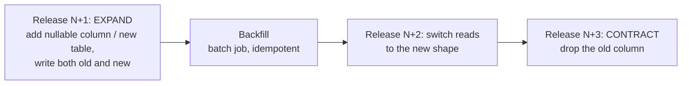

# Upgrades

How to move a running Spine to a new version without losing data, and what "rollback"
means when the database schema has changed.

## Versions and image tags

- Releases are tagged `vX.Y.Z` by release-please from Conventional Commits (ADR-0025).
  Breaking changes (major) are called out in `CHANGELOG.md`.
- Build and deploy images by **immutable tag** (`spine-api:1.4.2`, or better
  `spine-api@sha256:…`), never `latest`/`local`: the same tag must always mean the same
  bytes, otherwise "roll back to the previous version" is not well defined. Compose uses
  `SPINE_IMAGE_TAG` for this.
- The API and the worker always run the **same** image version (one image, ADR-0081).

## Migrations are forward-only

`apps/api/migrations/*.sql` are applied in filename order by the API at start
(`MIGRATE_ON_START=true`) and recorded with a SHA-256 checksum in `schema_migrations`
(ADR-0006). The migrator refuses to start if an applied file was edited. There are **no
down migrations**: a "down" script is code that is never tested until the worst possible
moment, and it can't bring back data that an "up" deleted.

### Expand / contract

Every schema change that old code would trip over is split across releases so that
**version N and N+1 both work with the schema in between**. That is what makes a rolling
deploy (and a rollback) safe.



| Change                      | Safe way                                                                                       |
| --------------------------- | ---------------------------------------------------------------------------------------------- |
| Add a column                | Nullable or with a constant default (instant in PG ≥ 11)                                       |
| Rename a column             | Add new → dual-write → backfill → read new → drop old (four steps, never `RENAME` in one)      |
| Add `NOT NULL`              | Add `CHECK (col IS NOT NULL) NOT VALID`, backfill, `VALIDATE CONSTRAINT`, then set `NOT NULL`  |
| Add an index on a big table | `CREATE INDEX CONCURRENTLY` in its own migration (it cannot run inside a transaction)          |
| Drop a column/table         | Only after a release that no longer reads or writes it has been deployed everywhere            |
| Change an event payload     | New `version` of the event type; handlers accept both until old events have drained (ADR-0009) |

## Upgrade procedure (Compose)

```bash
# 0. Read the CHANGELOG for the target version.
# 1. Back up (backup-restore.md) and check the dump is readable.
# 2. Pull/build the new images.
SPINE_IMAGE_TAG=1.5.0 docker compose -f infra/docker-compose.yml --env-file .env build
# 3. Apply: the API starts, migrates, becomes healthy; then the worker and nginx follow.
SPINE_IMAGE_TAG=1.5.0 make up
# 4. Verify.
curl -s localhost:8080/readyz            # {"status":"ready", … "migrations":"ok"}
# Grafana: error ratio and latency unchanged, outbox backlog draining.
```

During step 3 the old worker drains in-flight jobs on SIGTERM (graceful shutdown, up to
`SHUTDOWN_TIMEOUT_MS`), and BullMQ redelivers anything unfinished to the new one.

## Rollback = roll forward

Because migrations are forward-only and expand/contract keeps the previous release
compatible with the new schema:

1. **Application bug, schema change was "expand" only** → redeploy the previous image tag.
   The old code ignores the new nullable column/table. This is the common case.
2. **A migration itself is wrong** → write a **new** migration that fixes it and release
   that (roll forward). Never edit or delete an applied migration file.
3. **Data was destroyed** (a contract step ran too early) → restore from backup into a
   new database ([backup-restore.md](backup-restore.md)) and replay what you can. This is
   why contract steps ship one release later than you'd like.

## Dependency and base-image upgrades

- npm: Dependabot's weekly grouped PRs; each must pass CI including `pnpm audit` (ADR-0022, ADR-0028).
- OpenTelemetry: one group, upgraded together (ADR-0080).
- Base images: bump the tags in `infra/docker/*.Dockerfile` and `docker-compose.yml`;
  the `docker-build-scan` job (ADR-0085) fails on fixable HIGH/CRITICAL findings, and the
  weekly scheduled run catches new CVEs in unchanged images.
- PostgreSQL major versions (16 → 17): `pg_dump` from the old, `pg_restore` into the new
  (or `pg_upgrade` on large databases), tested on a copy first.
