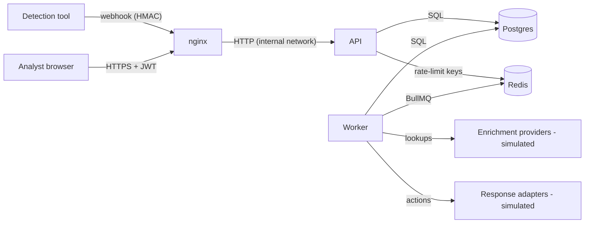

# Threat model (STRIDE per component)

> **Status:** v1, written at design time (Phase 0) and revised during the Phase 3
> adversarial review. Every mitigation links to the code or ADR that implements it, and
> items marked ⏳ are planned but not yet verified by a test.

## 1. Scope and assets

**Assets** (what an attacker wants):

| Asset                               | Why it matters                                                                                                                 |
| ----------------------------------- | ------------------------------------------------------------------------------------------------------------------------------ |
| A1 Response capability              | Playbooks can block IPs or open tickets. Abuse = denial of service against the org, or hiding an attack (e.g. closing alerts). |
| A2 Alert data                       | Contains internal hostnames, users, IPs, which is valuable reconnaissance.                                                     |
| A3 Credentials and sessions         | Analyst/admin accounts, JWT secret, webhook secrets.                                                                           |
| A4 Audit trail                      | Integrity is required for incident forensics and compliance.                                                                   |
| A5 Availability of ingestion        | If alerts can't get in, attacks go unseen.                                                                                     |
| A6 Playbook and ruleset definitions | Tampering silently changes how the SOC responds.                                                                               |

**Trust boundaries:**

```
[Internet / detection tools] ──TB1──▶ [nginx] ──TB2──▶ [API] ──TB3──▶ [Postgres, Redis]
[Analyst browser]            ──TB1──▶                    │
                                                          └──TB4──▶ [Worker] ──TB5──▶ [simulated adapters / providers]
```

## 2. Data-flow diagram



## 3. STRIDE analysis

### 3.1 Ingestion endpoints (webhooks, POST /alerts, batch)

| Threat              | Example                                                                                     | Mitigation                                                                                                                                                                            | Status     |
| ------------------- | ------------------------------------------------------------------------------------------- | ------------------------------------------------------------------------------------------------------------------------------------------------------------------------------------- | ---------- |
| **S**poofing        | Attacker POSTs fake alerts to trigger blocking of a legitimate IP (A1)                      | HMAC-SHA256 over `timestamp.body` with a per-source secret, constant-time compare, ±5 min window ([ADR-0017](../adr/0017-rbac-model.md)); user-submitted alerts need the analyst role | ⏳ Phase 1 |
| **T**ampering       | Modified payload in transit                                                                 | TLS at nginx; HMAC covers the body                                                                                                                                                    | ⏳         |
| **R**epudiation     | "We never sent that alert"                                                                  | `source` + webhook principal recorded in the audit log                                                                                                                                | ⏳         |
| **I**nfo disclosure | Error messages leaking internals                                                            | RFC 9457 problems, never stack traces ([problem.ts](../../apps/api/src/platform/http/problem.ts)), unit-tested                                                                        | ✅         |
| **D**oS             | Alert flood exhausts the DB/queue (A5)                                                      | Body limits (1 MiB / 10 MiB batch), per-source rate limits, outbox-backlog back-pressure → 503 + Retry-After ([ADR-0024](../adr/0024-api-conventions.md))                             | ⏳         |
| **D**oS             | Replay of a captured webhook                                                                | Timestamp window + idempotency/fingerprint dedup                                                                                                                                      | ⏳         |
| **E**oP             | Payload injects playbook-controlled fields (e.g. a crafted `labels` key used in a template) | Templates are plain path lookups, never evaluated; adapters escape output ([ADR-0013](../adr/0013-playbook-dsl.md))                                                                   | ⏳         |

### 3.2 API (authentication, sessions, RBAC)

| Threat | Example                                               | Mitigation                                                                                                                                                          | Status         |
| ------ | ----------------------------------------------------- | ------------------------------------------------------------------------------------------------------------------------------------------------------------------- | -------------- |
| S      | Credential stuffing on /auth/login                    | argon2id, per-IP **and** per-username rate limits, generic error message, dummy hash on unknown user (no enumeration)                                               | ⏳             |
| S      | Stolen refresh token                                  | Rotation with reuse detection revokes the whole token family ([ADR-0016](../adr/0016-authentication-jwt-refresh-rotation.md))                                       | ⏳             |
| S      | JWT `alg:none` / algorithm confusion                  | Algorithm pinned to HS256 on verify; `iss`/`aud` checked                                                                                                            | ⏳             |
| T      | CSRF on cookie-authenticated refresh                  | `SameSite=Strict` + Origin allow-list + custom `X-Spine-CSRF` header                                                                                                | ⏳             |
| R      | Analyst denies approving a block                      | Approval decisions are written to the append-only audit log with actor and request ID                                                                               | ⏳             |
| I      | IDOR: viewer reads admin-only data                    | Route-level RBAC, deny-by-default: the server refuses to start with a route lacking a policy ([server.ts](../../apps/api/src/platform/http/server.ts)), unit-tested | ✅             |
| I      | Password hash leaks via API                           | Response schemas exclude it, and response serialization strips undeclared fields (tested)                                                                           | ✅ (mechanism) |
| D      | Expensive queries (unbounded page size, regex search) | `limit ≤ 200`, `q` ≤ 200 chars using a trigram index, statement timeout of 30 s                                                                                     | ⏳             |
| E      | Analyst publishes a playbook                          | Publishing requires admin; RBAC matrix test                                                                                                                         | ⏳             |

### 3.3 Playbook engine and response adapters

| Threat | Example                                             | Mitigation                                                                                                                                                       | Status                          |
| ------ | --------------------------------------------------- | ---------------------------------------------------------------------------------------------------------------------------------------------------------------- | ------------------------------- |
| T / E  | Malicious playbook runs code                        | No `eval`/`vm`; closed predicate language; schema-validated step types only ([ADR-0013](../adr/0013-playbook-dsl.md))                                            | ✅ (interpreter + schema tests) |
| D      | ReDoS via `matches` conditions                      | Heuristic safe-regex check at load, pattern ≤ 200 chars, input truncated to 4096 chars ([condition-eval.ts](../../packages/shared-schema/src/condition-eval.ts)) | ✅ unit-tested                  |
| D      | Playbook loops forever                              | DAG validation rejects cycles; max 100 steps; per-step timeout                                                                                                   | ⏳                              |
| T      | Duplicate side effects after a crash (double block) | Idempotency keys `runId:stepId` on every adapter call ([ADR-0010](../adr/0010-event-sourcing-for-playbook-runs-only.md))                                         | ⏳                              |
| E      | Real destructive action                             | Only simulated adapters exist; code-review rule ([ADR-0018](../adr/0018-simulated-response-adapters.md))                                                         | ✅ by design                    |
| R      | "Automation closed the alert, not me"               | Every run event is persisted (event-sourced history)                                                                                                             | ⏳                              |

### 3.4 Data stores

| Threat | Example                                  | Mitigation                                                                                                              | Status               |
| ------ | ---------------------------------------- | ----------------------------------------------------------------------------------------------------------------------- | -------------------- |
| T      | Audit log rewritten by a compromised app | DB trigger rejects UPDATE/DELETE on `audit_log` (integration-tested)                                                    | ✅                   |
| I      | SQL injection                            | Kysely parameterizes all values; no string-built SQL outside migrations                                                 | ✅ by construction   |
| I      | Secrets in logs                          | pino redaction paths for authorization, cookies, passwords, tokens ([logger.ts](../../apps/api/src/platform/logger.ts)) | ✅ (config), ⏳ test |
| D      | Redis loss                               | Redis holds only re-creatable state; runs are reconciled from Postgres on startup                                       | ⏳                   |

### 3.5 Console (browser)

| Threat | Example                         | Mitigation                                                                                                                                  | Status             |
| ------ | ------------------------------- | ------------------------------------------------------------------------------------------------------------------------------------------- | ------------------ |
| I / E  | XSS steals tokens               | Access token kept in memory only; refresh cookie is HttpOnly; React escapes by default; no `dangerouslySetInnerHTML`; strict CSP from nginx | ⏳                 |
| T      | Clickjacking the approve button | `frame-ancestors 'none'`                                                                                                                    | ✅ (API), ⏳ nginx |

### 3.6 Supply chain and CI

| Threat                      | Mitigation                                                                                                                                                  | Status |
| --------------------------- | ----------------------------------------------------------------------------------------------------------------------------------------------------------- | ------ |
| Malicious dependency update | Exact pins + frozen lockfile + `onlyBuiltDependencies` allow-list ([ADR-0022](../adr/0022-dependency-pinning-and-version-policy.md)), npm audit, Dependabot | ⏳ CI  |
| Secret committed to Git     | gitleaks in CI; `.env` ignored; `.env.example` contains placeholders only                                                                                   | ⏳ CI  |
| Vulnerable base image       | Trivy scan in CI; slim/distroless non-root images                                                                                                           | ⏳     |

## 4. Residual risks (accepted for v0.1)

- **Single shared HS256 secret**: compromise of the API host compromises all tokens. Accepted; see ADR-0016 "revisit".
- **No MFA**: delegated to a future OIDC integration.
- **Heuristic ReDoS check**: conservative but not a proof. Mitigated by the input length cap.
- **Coarse RBAC**: any analyst can approve any action.

## 5. How to update this document

Add a row whenever a new entry point, data store or privileged action is introduced.
Mark a mitigation ✅ only when a test (link it) or a reviewed configuration proves it.
