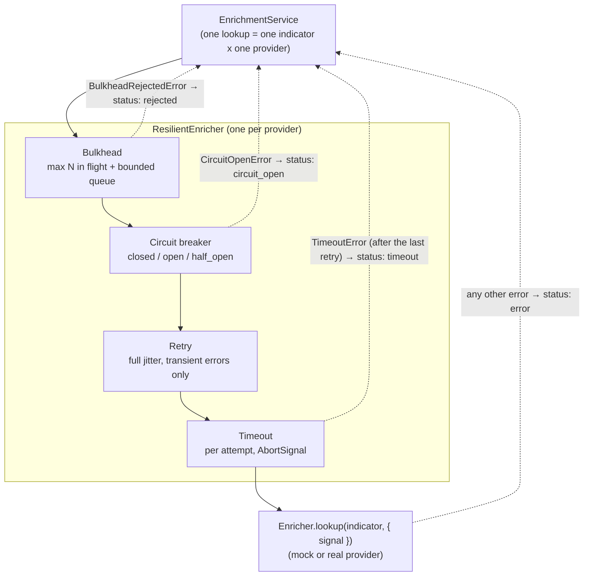
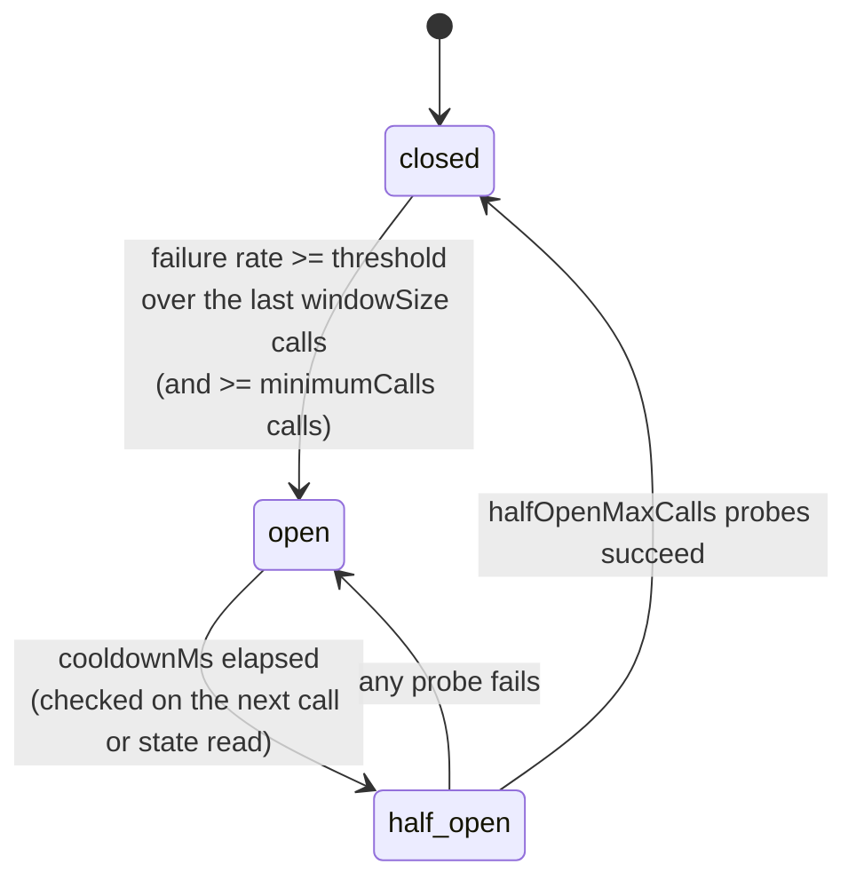

# @spine/enrichers

The enrichment extension point, hand-written resilience primitives and fixture-driven mock
providers for Spine ([ADR-0014](../../docs/adr/0014-hand-written-resilience-primitives.md)).

Framework-free: no HTTP server, database or logger. Everything here runs, and is tested,
in plain Node, deterministically, in fake time. The API's
[enrichment module](../../docs/modules/enrichment.md) wires it to Postgres, events and metrics.

## What's inside

| File                                              | What it is                                                                                     |
| ------------------------------------------------- | ---------------------------------------------------------------------------------------------- |
| `src/enricher.ts`                                 | The `Enricher` port: **the one interface a new provider implements**                           |
| `src/resilience/timeout.ts`                       | `withTimeout(fn, ms)`: per-attempt budget; aborts the provider's `AbortSignal` with the reason |
| `src/resilience/retry.ts`                         | `retry(...)`: exponential backoff with **full jitter**; transient errors only; abort-aware     |
| `src/resilience/circuit-breaker.ts`               | `CircuitBreaker`: count-based rolling window, cooldown, half-open probes, `onStateChange`      |
| `src/resilience/bulkhead.ts`                      | `Bulkhead(maxConcurrent, maxQueue)`: bounded concurrency + bounded FIFO queue, fail fast       |
| `src/resilience/compose.ts`                       | `composeResilience(...)`: stacks the four in the order fixed by ADR-0014                       |
| `src/resilient-enricher.ts`                       | `ResilientEnricher`: one provider + its own bulkhead and breaker; `DEFAULT_RESILIENCE`         |
| `src/enrichment-service.ts`                       | `EnrichmentService`: all lookups for one alert, bounded concurrency, **never throws**          |
| `src/targets.ts`                                  | Which indicators to look up for an alert (indicators + host), normalized and de-duplicated     |
| `src/mock/*` + `fixtures/*.json`                  | Mock `reputation`, `geo` and `asset-inventory` providers with seeded fault injection           |
| `src/time.ts`, `src/testing/virtual-scheduler.ts` | The `Scheduler` port (clock + timers) and a virtual-time implementation for tests              |

## The resilience stack

Every provider call goes through four layers, outermost first. Each layer has one job and
one error type, which the enrichment service maps to a result status.



Why this order (from ADR-0014):

- **Bulkhead outermost**: it bounds the total concurrency against the provider, _retries
  included_. A slow provider can tie up only its own slots.
- **Breaker outside retry**: one logical call counts once toward the failure rate, and an
  open breaker skips all the retries at once instead of hammering a dead provider three times.
- **Timeout per attempt**: one slow attempt doesn't burn the whole budget; retry gets another go.

The circuit breaker's state machine:



## Usage

```ts
import {
  createMockEnrichers,
  EnrichmentService,
  ResilientEnricher,
  DEFAULT_RESILIENCE,
} from '@spine/enrichers';

const providers = createMockEnrichers({ latencyMs: 30, failureRate: 0.1, seed: 42 }).map(
  (enricher) =>
    new ResilientEnricher(enricher, DEFAULT_RESILIENCE, {
      onStateChange: (provider, { from, to }) => console.log(provider, from, '→', to),
    }),
);
const service = new EnrichmentService(providers, { concurrency: 8 });

const results = await service.enrich({
  indicators: [{ type: 'ipv4', value: '203.0.113.66' }],
  host: { hostname: 'dc01.corp.example' },
});
// → EnrichmentResult[]: status ok | not_found | timeout | error | circuit_open | rejected
```

## Writing a new provider

Implement `Enricher` (four members) and nothing else. Don't add timeouts or retries
inside it: `ResilientEnricher` adds those. Throw `TransientProviderError` for failures
worth retrying, honour `context.signal`, and return `found(data, verdict)` or `notFound()`.
See the [enrichment module guide](../../docs/modules/enrichment.md#how-to-extend-it).

## Mock data

The fixtures use only documentation IP ranges (`192.0.2.0/24`, `198.51.100.0/24`,
`203.0.113.0/24`, `2001:db8::/32`), private ranges, reserved domains (`*.example`, `*.test`),
documentation AS numbers (64496–64511) and well-known test hashes (EICAR, empty file).
Fault injection (`latencyMs`, `failureRate`, `seed`) uses a seeded PRNG, so the same seed
gives the same failures on every run ([ADR-0045](../../docs/adr/0045-deterministic-mock-providers.md)).

## Testing

```bash
pnpm --filter @spine/enrichers test            # unit + property tests (fast-check)
pnpm --filter @spine/enrichers test:coverage   # enforced: >= 85 % lines/branches/functions
```

Property tests state the invariants: the bulkhead never exceeds `maxConcurrent` in flight
under random interleavings and settles every call; the breaker never lets a call through
while open before the cooldown; retry delays always lie in `[0, cap]` and attempts never
exceed `maxAttempts`; a timeout always settles exactly once and leaves no timer behind.
All of them run in virtual time (`VirtualScheduler`): no test sleeps.
