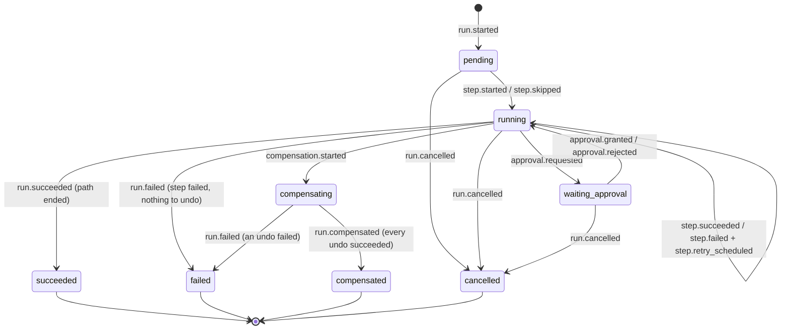

# @spine/playbook-engine

Pure, framework-free playbook DSL validation and **durable execution** engine for Spine
([ADR-0010](../../docs/adr/0010-event-sourcing-for-playbook-runs-only.md),
[ADR-0013](../../docs/adr/0013-playbook-dsl.md),
[ADR-0050](../../docs/adr/0050-playbook-engine-reduce-decide-act.md)).

The package performs **no I/O**. Storage, step implementations and time come in through
ports, so the whole engine is tested in milliseconds, including property tests that crash
runs at random points and check that they resume correctly.

## What's inside

| Export                               | What it does                                                                                                                                                                                                 |
| ------------------------------------ | ------------------------------------------------------------------------------------------------------------------------------------------------------------------------------------------------------------ |
| `parsePlaybook(source, format)`      | YAML (locked down: no tags, ≤ 50 alias expansions, no duplicate keys) or JSON, ≤ 256 KiB → `{ valid: true, definition }` or **all** errors as `{ path, message }[]` (paths like `steps[3].next`).            |
| `validatePlaybook(value)`            | The same for an already-parsed value: Zod schema, then graph rules: unique IDs, `start` exists, references exist, **acyclic** (reports the cycle path), reachable, condition depth ≤ 16, ReDoS-safe regexes. |
| `reduce(definition, events)`         | Folds a run's event log into a `RunState` (status, per-step state, current step, completed steps in order, pending approval, compensation progress). Pure and deterministic.                                 |
| `decide(definition, state, { now })` | Returns the next action: `ExecuteStep`, `ScheduleRetry`, `WaitForRetry`, `RequestApproval`, `WaitForApproval`, `SkipStep`, `Compensate`, `Finish` or `Halt`.                                                 |
| `advance(runId, ports)`              | The executor loop: load → reduce → decide → act → append, until the run is terminal or must wait.                                                                                                            |
| `buildEvaluationContext`             | The read-only context `{ alert, score, enrichment, steps, run }` that conditions and templates see.                                                                                                          |

## Run statuses



`pending` means "the run exists and its inputs are fixed, but no step has started yet".
The four terminal statuses are never left.

## Durable execution, from first principles

A playbook run can take hours: it may wait for an analyst to approve a firewall block. During
that time the worker process can be redeployed, crash or be OOM-killed. "Durable execution"
means **the run continues correctly anyway**, without repeating side effects that already
happened. The engine gets there with four ideas:

1. **The event log is the only truth.** Every fact (`step.started`, `step.succeeded`,
   `approval.granted`…) is appended to a log with a gap-free sequence number. Nothing is
   kept in memory between steps.
2. **State is a pure function of the log.** `reduce(definition, events)` rebuilds the run's
   state from scratch, so resuming after a crash is just "load the events and reduce".
3. **The next step is a pure function of the state.** `decide` never looks at anything but
   the state and the current time. Ask it about any log, including one cut short by a
   crash, and it tells you exactly what to do.
4. **Side effects are recorded before and after, and carry idempotency keys.** The executor
   appends `step.started` _before_ calling a handler and `step.succeeded` _after_. A crash
   between the two leaves "started but not finished", so the step is re-executed, **with the
   same idempotency key** `${runId}:${stepId}:${attempt}`. The adapter (e.g. the simulated
   firewall) sees the same key and returns its original result instead of acting twice.

Two writers can race, e.g. a retried job and a resumed one. Appends use optimistic
concurrency: the writer says which `seq` it expects to follow, and the store refuses if
someone got there first (`ConcurrencyError`). The loser reloads and decides again.

### What each action does

| Action            | Executor behaviour                                                                                                                   |
| ----------------- | ------------------------------------------------------------------------------------------------------------------------------------ |
| `ExecuteStep`     | Append `step.started` (unless resuming), call the handler with a per-step timeout (`AbortSignal`), append `step.succeeded`/`failed`. |
| branch steps      | Evaluated by the engine with `evaluateCondition`; `step.started` + `step.succeeded {taken}` are appended together.                   |
| `ScheduleRetry`   | Append `step.retry_scheduled {notBefore}` and return, so the host schedules a delayed job. Backoff: `backoffMs × 2^(attempt−1)`.     |
| `RequestApproval` | Call the `approval` handler (it creates the approval record), append `step.started` + `approval.requested`, then wait.               |
| `SkipStep`        | Dry runs skip approval gates (recorded as `step.skipped`).                                                                           |
| `Compensate`      | Saga: call `compensate` of completed steps in reverse completion order, then `run.compensated` or `run.failed`.                      |

## Using it

```ts
import { advance, parsePlaybook } from '@spine/playbook-engine';

const parsed = parsePlaybook(yamlText, 'yaml');
if (!parsed.valid) console.table(parsed.errors);

const result = await advance(runId, { store, handlers, clock });
// result.outcome: terminal | waiting_approval | retry_scheduled (notBefore) | yielded | not_found
```

`store` implements `RunStore` (`load` + `append(runId, expectedSeq, events)`), `handlers`
maps step types to `{ execute, compensate? }`, and `clock` provides `now()`. See
`apps/api/src/modules/playbooks` for the production adapters (Postgres, BullMQ, simulated
response actions).

## Tests

```bash
pnpm --filter @spine/playbook-engine test            # unit + property tests
pnpm --filter @spine/playbook-engine test:coverage   # ≥ 85 % lines and branches enforced
```

`test/properties.test.ts` holds the properties (fast-check): random valid DAGs are
accepted and mutated ones rejected; succeeding runs execute each step on the taken path
exactly once; truncating or crashing a run at any point and resuming gives the same final
log with the same idempotency keys; `reduce` is deterministic; compensation runs in exact
reverse order.
